# KineX User Guide

Your reading, excerpts, handwritten notes and reviews in one place.

KineX lets you read and, as you go, move what matters onto a board to work it through, then turn what you want to remember into flashcards. Every step keeps its source, so you can always get back to the original text.

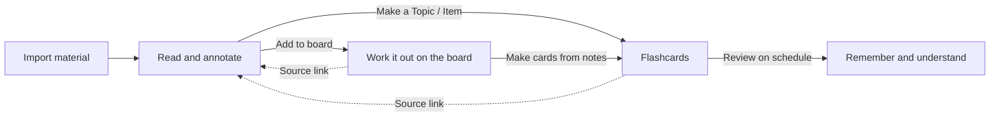

This guide describes KineX as of 25 October 2026. KineX is still in beta, so buttons may move or be renamed.

<!-- md-only -->
The diagrams are written in Mermaid: Typora, Obsidian, GitHub and VS Code show them as pictures; other readers show the text, which reads fine on its own. Web version: kinexnote.com/guide/.

## Contents

1. [Your first read and excerpt](#quick-start)
2. [The home page and the workspace](#workspace)
3. [Themes and materials](#materials)
4. [Reading, annotating and excerpting](#reading)
5. [Working on the board](#whiteboard)
6. [Flashcards, incremental reading and writing](#flashcards)
7. [Learning from audio and video](#media)
8. [Read-aloud and listening](#read-aloud)
9. [Recordings linked to notes](#recording)
10. [Search and favourites](#search)
11. [Study statistics and points](#learning)
12. [Library and sync across devices](#sync)
13. [Self-hosting KineX Sync](#self-hosted-sync)
14. [Export, backup and restore](#backup)
15. [Your KineX account and activation codes](#account)
16. [Feedback and the roadmap](#feedback)
17. [Updates and notifications](#updates)
18. [Appearance, pen, touch gestures and shortcuts](#settings)
19. [FAQ](#faq)
<!-- /md-only -->

KineX's interface is in Chinese for now. Where it helps you find a button, this guide gives its Chinese label in brackets, for example *Add to board* (添加到白板).

### I want to…

| I want to… | Read |
|---|---|
| Get going: one full round in ten minutes | [Chapter 1](#quick-start) |
| Put the key points of a book on the board | [Chapter 4 · Put key points on the board](#reading) |
| Turn what I must remember into cards and review them; know which study methods really work | [Chapter 6](#flashcards) |
| Listen to a book, or let my computer use my phone's voice | [Chapter 8](#read-aloud) |
| Sync between computer, tablet and phone | [Chapter 12](#sync); with a NAS, also [chapter 13](#self-hosted-sync) |
| Back up a theme or get earlier content back | [Chapter 14](#backup) |
| Sign in and redeem an activation code | [Chapter 15](#account) |
| Report a problem, suggest something, see what's planned | [Chapter 16](#feedback) |
| Update to a new version | [Chapter 17](#updates) |
| Change shortcuts or tablet gestures | [Chapter 18](#settings) |

<a id="quick-start"></a>

## 1. Your first read and excerpt

For your first try, take a PDF or an e-book and go through these steps.

1. **Create a theme.** On the home page, click *New* (新建) and give it a name you will recognise, such as “Photography basics”.
2. **Import a material.** Open the theme, click “＋” in the materials panel → *Import material* (导入材料) and pick a file. On a computer you can also drag files into the panel.
3. **Start reading.** Open what you imported: the reader shows the text, the board holds your notes.
4. **Excerpt one key point.** Mark a passage with the highlighter, click the highlight and choose *Add to board* (添加到白板).
5. **Write your own take.** Add a text card on the board with a summary, a question or an example.
6. **Go back to the source.** Use the excerpt card's source link and check that it takes you back to the same spot.

You now have a study note with its source attached. Bring in flashcards, read-aloud and sync when you need them.

<video controls preload="none" playsinline poster="assets/v01-first-excerpt.jpg" src="assets/v01-first-excerpt.mp4"></video>

*A new theme → import a PDF → highlight a sentence → add it to the board → back to the text through the card’s source.*

<a id="workspace"></a>

## 2. The home page and the workspace

### A few names

| Name | What it is for |
|---|---|
| Library | Holds a full set of themes, materials, boards, flashcards and study records |
| Reading theme | Organises material around a book, a course or a question |
| Material | A book, document, web page, audio or video in a theme |
| Reader | Where you read, play media, annotate and excerpt |
| Board | Where cards, images, handwritten notes and links are laid out |
| Flashcards | Schedule things to read again, or review them as questions, cloze deletions and so on |

How they fit together:

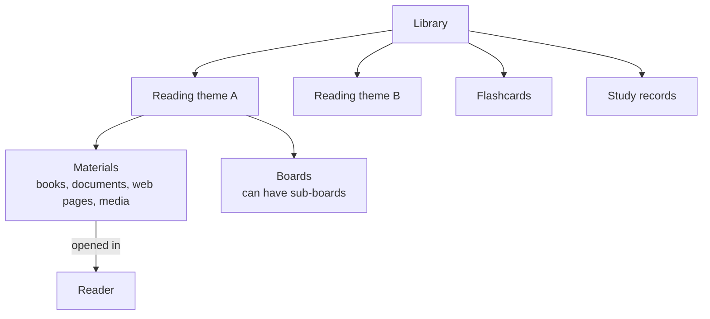

### The home page

*Overview* (概览) picks up where you left off, shows today's study and your bookshelf; *Library* (仓库) is where you manage themes. You can put themes into folders, favourite them, or mark them *Want to read / Reading / Finished*.

On a computer, click a theme to select it and double-click to open it; on a touch screen, tap to open. More actions are in the right-click or long-press menu.

Search, statistics, sync and other entries not shown in the top bar are under “⋯”. On the desktop you can pin the ones you use most to the top bar.

**On a phone**, the home page has a tab bar at the bottom: Overview · Library · Favourites · Recent · More. *More* slides out the full navigation from the left, with tags, unfiled, missing materials, archive and folders.

### The theme workspace

A workspace usually shows the reader and the board, side by side or one above the other; drag the divider to resize them. Enlarge the reader to focus on reading, or the board to work on your notes.

On a computer, one key switches the layout:

| Layout | Default key | Other ways |
|---|---|---|
| Reader at 100% (press again to go back side by side) | Alt+1 | Drag the divider past the edge and release when it says “Release: 100% reader” |
| Reader and board side by side | Alt+2 | Double-click the divider to split them evenly |
| Board at 100% (press again to go back) | Alt+3 | Drag the divider past the other edge |
| Switch to the other side | Alt+Q | — |
| Left-right / top-bottom; swap sides | Alt+\; Alt+Shift+\ | — |

With the board at 100%, clicking an excerpt's source switches straight to the reader at 100% and finds the place; a *Back to board* (返回白板) button appears at the bottom. The other way round, jumping to a board card from search, favourites or flashcards brings up *Back to reading* (返回阅读). When you excerpt with the reader at 100%, a note at the bottom says the excerpt is on the board, with a link to look at it.

### The workspace on a phone

On a phone a theme opens with the reader at 100%; the board is a second full page.

- **Switch between reading and board:** swipe left or right on the narrow bar at the top.
- **More theme actions:** tap or pull down the top bar. Its *Layout* offers Reader / Stacked / Board; the row below has Home, Recording, Favourites and More.
- **Reading bar:** tap the middle of the page for Contents · Materials · Progress · Layout · Read aloud · Board. Drag *Progress* to jump; the bar hides after you pick an item, tap the page or wait three seconds.
- **Back to the home page:** swipe right from the left edge of the screen.

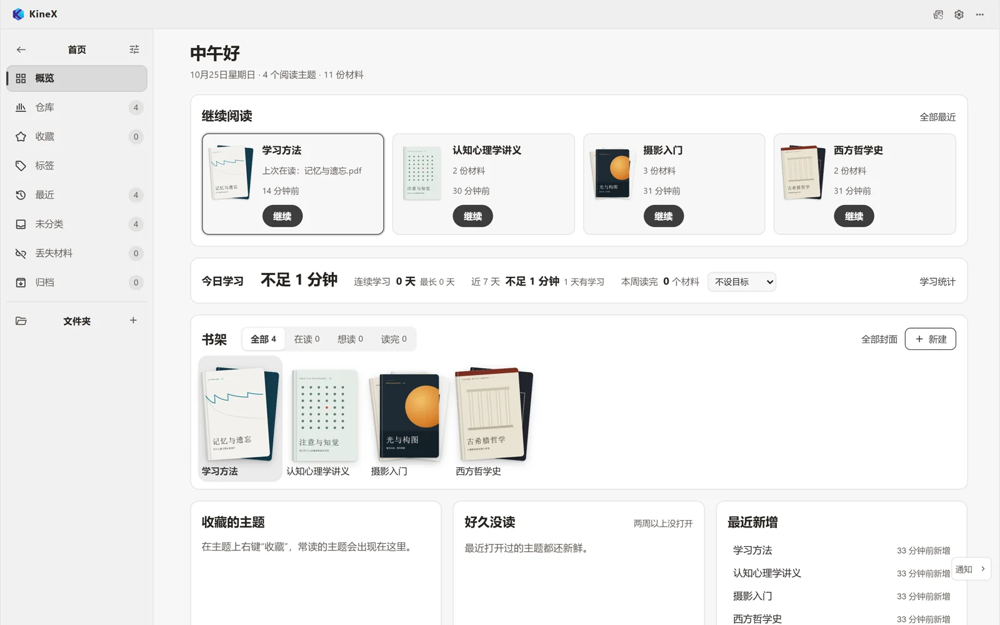

*The home page: continue reading, today’s study and the bookshelf. A theme’s cover fans out its materials’ covers.*

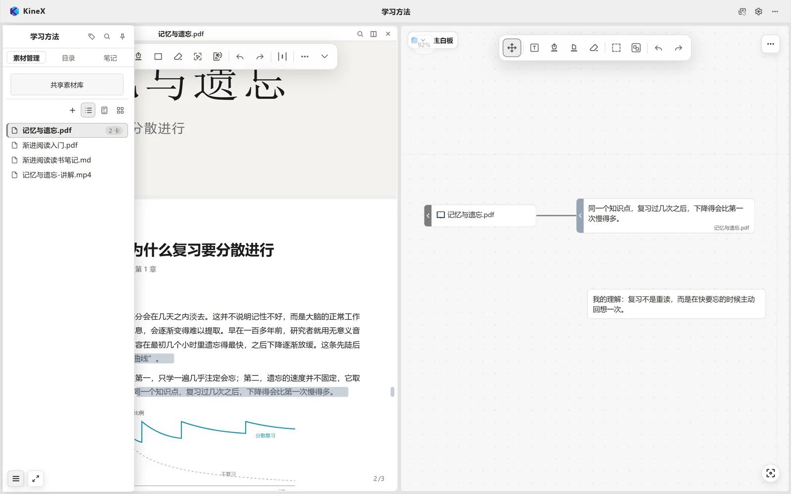

*A theme workspace: the materials panel and the reader on the left, the board on the right.*

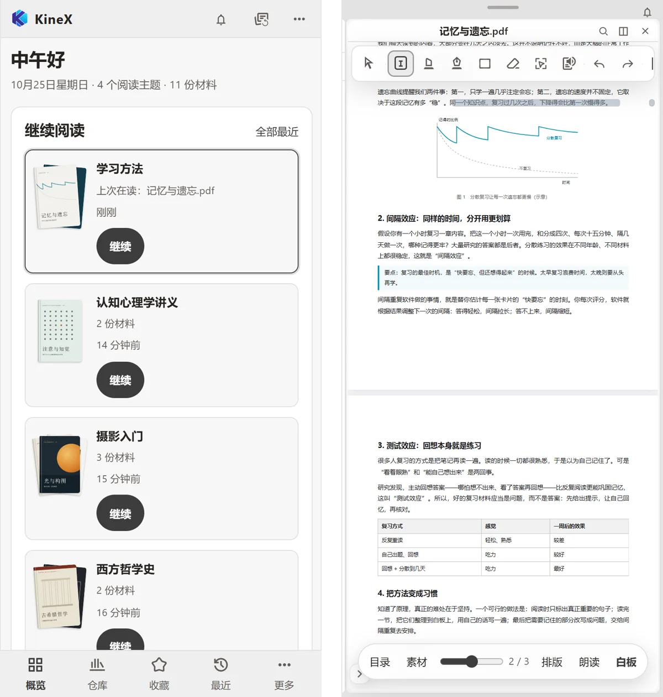

*On a phone: the home tab bar (left) and the reading bar that appears when you tap the middle of the page (right).*

<video controls preload="none" playsinline poster="assets/v05-phone.jpg" src="assets/v05-phone.mp4"></video>

*On a phone: open a theme → swipe the top bar to the board → swipe back → tap the middle of the page for the reading bar.*

<a id="materials"></a>

## 3. Themes and materials

### Organising themes

Right-click or long-press a theme to rename it, favourite it, archive it, set its cover, see its details and more.

- **Folders:** keep related themes together.
- **Favourites:** keep the themes you use most within easy reach.
- **Archive:** move themes you are not using out of the daily lists; they stay in the archive.
- **Reading status:** mark *Want to read*, *Reading* or *Finished* to filter by.

Archiving does not delete a theme. Before deleting, read the confirmation and check what it will affect.

### Adding material

Click “＋” in a theme's materials panel and choose by source:

| Entry | Good for |
|---|---|
| Import material (导入材料) | PDF, EPUB, MOBI, AZW3, FB2, TXT, HTML, Markdown, and local audio and video |
| Add web page (添加网页) | Extracts the text of a public article and keeps it as a readable material |
| Import Markdown folder (导入 Markdown 文件夹) | Markdown with its folder structure and attachments |
| Add media source (添加音视频来源) | Local files, media URLs, or audio and video on OpenList |

Web extraction may not work for pages that need a login or load their content dynamically. Save such a page as a web file or a Markdown bundle first, then import it.

Whether audio and video play depends on the codecs your device supports; DRM-protected e-books may not open.

### Audio and video: link or import?

When you add local audio or video, KineX asks how to keep it.

| Option | What happens to the file | When to use it |
|---|---|---|
| Link to the original (引用原文件) | Only its location is recorded; the file is not copied into the library | Large files you mostly use on this device |
| Import into the library (导入数据库) | The file becomes part of the library and goes with its backups and sync | You want to play it on other devices directly |

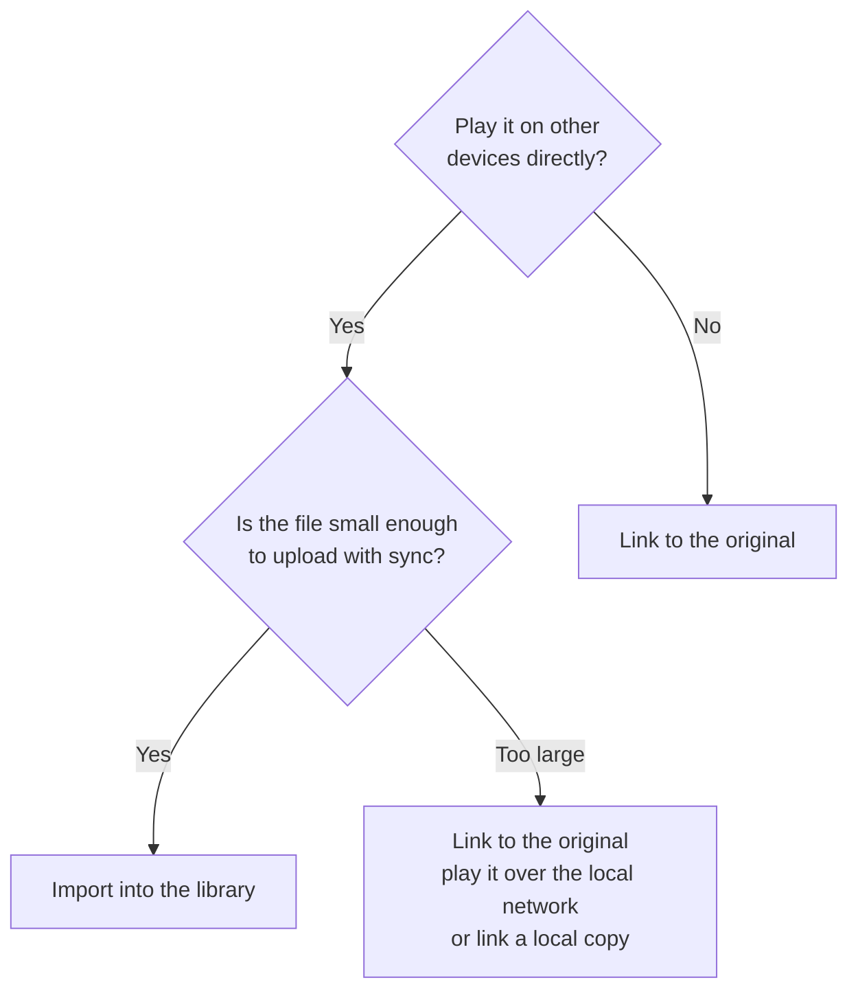

A linked file is never uploaded to the cloud. On another device, link that device's copy of the file, or play it from the original device while it is online on the same local network.

### Folders and tags

Material folders suit chapters, courses or sources; tags cut across folders, for example “read closely” or “key concept”. A material can carry several tags.

KineX keeps one tag tree for the whole library. Add or edit tags from a material's menu, or arrange them in tag management. The tag entry on the home page finds everything with a tag.

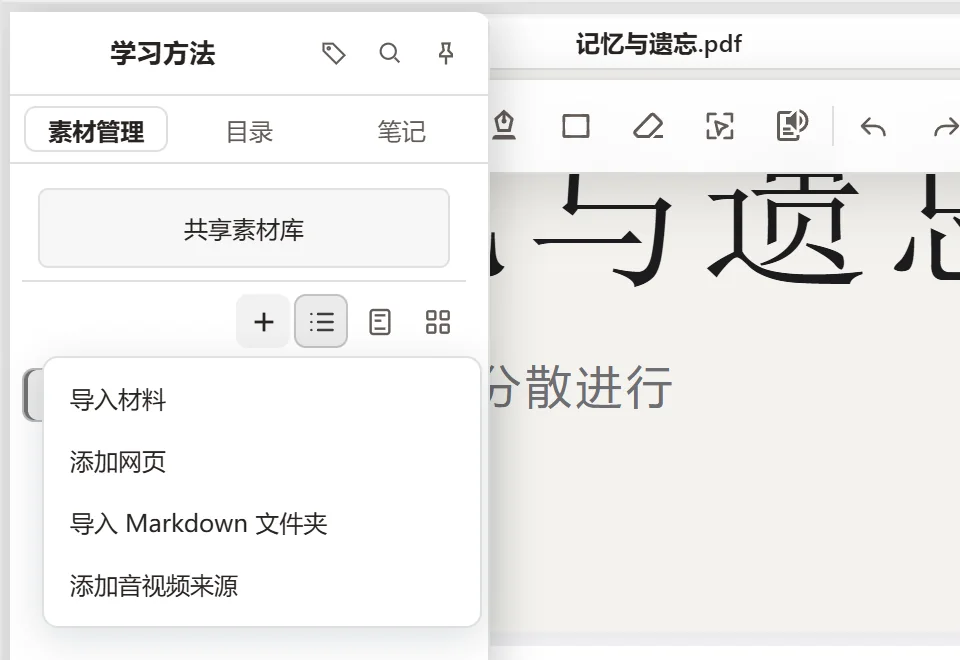

*The materials panel’s “＋” menu.*

<a id="reading"></a>

## 4. Reading, annotating and excerpting

### Finding your place

Open a material from the materials panel and use its table of contents to jump between chapters. A PDF shows the page number at the bottom right: click it to type a page; double-click empty space to fit the page width.

KineX reopens a material where you left it. To compare materials, split the reader; with several panes, click the pane you want to work in first.

### How the text looks

The reader's settings change paper colour, margins and layout. For e-books, TXT, Markdown and other text, you can also set font size, letter spacing, line spacing and paragraph spacing.

Type settings such as font size apply to the current material only and are saved on this device. To get the book's own layout back, use *Follow the book* (跟随书籍) or the matching reset button.

Choose the reading font in *Settings → Appearance → Reading font* (设置 → 外观 → 阅读字体). Scanned PDF pages are images: a different font does not make them selectable text.

### Highlights, handwriting and snapshots

| To… | Do this | Key in the reader |
|---|---|---|
| Select text | Switch to the text tool and drag over the text | T |
| Excerpt continuously | Turn on auto-excerpt | A |
| Mark a key point | Use the highlighter on the sentences to keep | H |
| Write on a PDF | Use the pen and write on the page | B |
| Excerpt a chart or a scanned page | Drag a box to snapshot it | R |
| Erase ink / select marks | Eraser / selection | E / M |
| Change an existing mark | Click the mark and use its menu | — |

Pressing the current tool's key again returns to the previous tool. These keys work while the pointer is over the reader.

You can write on PDFs; EPUB, TXT, Markdown and other text materials are mainly for selecting and highlighting. Annotations are stored in KineX and never change the imported file.

### Put key points on the board

1. Click a highlight or snapshot you have made.
2. Choose *Add to board* (添加到白板).
3. Arrange the new excerpt card on the board and add your own notes.
4. When you need the context, use the card's source link to go back to the text.

*Auto-excerpt* (自动摘录) on the reader toolbar sends suitable selections straight to the board, which suits excerpting one passage after another. Turn it off when you only want to select text, look up a word or make a card.

Excerpt cards keep their source. If the material has been deleted, replaced, or not yet synced to this device, KineX may not find the spot until the source is back.

### Working through your notes

If you prefer to read first and sort out later, open the *Notes* (笔记) page of the materials panel. It lists the current material's highlights and comments.

- **Not excerpted:** by default, only what is not on the board yet.
- **All:** also lists what is already on the board, marked as such.
- Click the text to go back to its place; *To board* (摘到白板) puts it on the board; *Delete* (删除) removes the mark after a confirmation, and you can undo it in the reader.

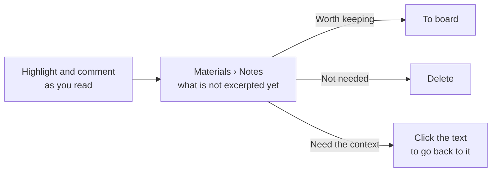

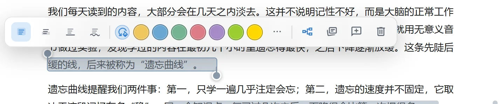

*The menu of a highlight: style, colour, and add to board, make a Topic, comment and delete.*

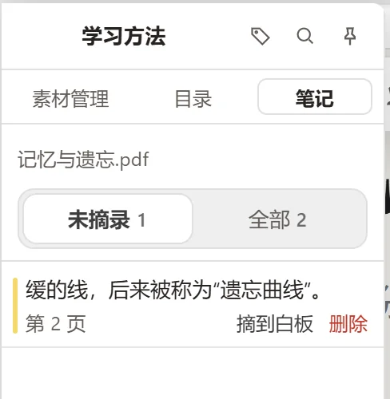

*Materials › Notes: a highlight not yet on the board.*

<a id="whiteboard"></a>

## 5. Working on the board

### Tools

| Tool | Use | Key |
|---|---|---|
| Move | Move the canvas around | V |
| Text box | New text card for a summary, a question or an example | T |
| Pen | Write or draw | B |
| Marker | Semi-transparent strokes for emphasis | H |
| Eraser | Erase whole strokes, or parts of strokes within an area | E |
| Selection | Select cards, images or ink to arrange them together | M |

Double-click a text card to edit it. Cards support common text styles, lists, code and formulas; type `/` at the start of a line for the insert menu. While editing a formula you type its source; when you finish, it is typeset.

### Moving, zooming and selecting

- Hold Space and drag to move the canvas for a moment; on a computer you can also drag with the middle mouse button.
- The vertical scroll wheel zooms, horizontal scrolling pans; on a touch screen, pan and zoom with two fingers.
- Drag a box with the selection tool to select several objects; hold Shift to add to the selection.
- With something selected you can move, copy, group, align or auto-arrange it; check the selection before deleting.
- Shift+1 toggles between the whole board and your set zoom; Shift+2 zooms to the selection; Alt+↑ returns to the parent board.

On touch screens the default is *Two-finger move* (双指移动): two fingers pan the canvas, one finger on empty space draws a selection box. If you prefer moving the canvas with one finger, switch to *One-finger move* (单指移动) in the board's Move tool options or in *Settings → Touch gestures*.

Undo works on the current board. With several boards open, click the one you want to change first.

### Pen, mouse and fingers

A stylus works with pressure straight away. To draw with a mouse or finger, turn on the matching switch first; if the mouse only moves the canvas, check that switch.

Pick the pen type, colour and width in the pen settings. Watercolour and crayon need a sheet of paper (画纸) to draw on; a sheet also keeps a piece of work together.

**Cards and sheets scale differently:** ink attached to a card follows the card; sheets and groups mainly resize their frame, and the text and ink inside do not scale with it.

### Structure and links

The structure “＋” on a card adds child nodes, good for outlines and hierarchies. Draw with the pen from one card to another to link them.

The ends of a link take you from one card to the other. An excerpt card's source link takes you back to the reading material; the two do different jobs.

### Several boards

A theme can have several boards. Right-click or long-press empty space and choose *New sub-board* (新建子白板); the parent board gets an entry card: double-click it, or select it and press Enter, to go in.

The board list switches and renames boards, and *Open beside* (在旁边打开) shows two side by side. Then you can drag content from one board to the other; hold Alt while dragging to copy instead.

*Reference a board from another theme* (引用其他主题的白板) opens the original: edits are saved to that theme. To change a separate copy, copy the content instead.

On the desktop you can also detach a board into its own window, handy with two screens.

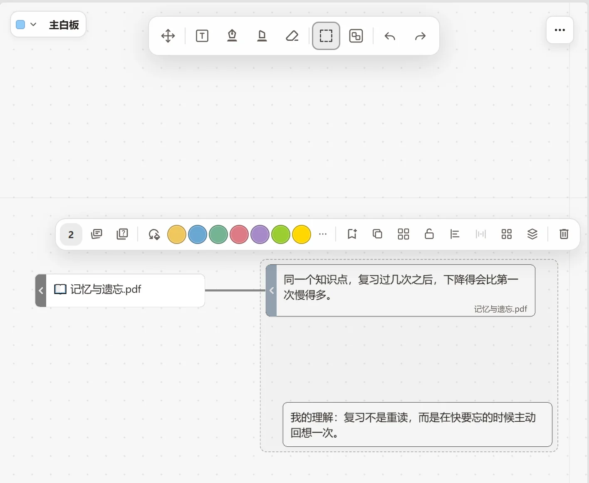

*The selection bar after box-selecting cards.*

<video controls preload="none" playsinline poster="assets/v02-board.jpg" src="assets/v02-board.mp4"></video>

*A new card → three cards arranged in a column → a new sub-board → opened beside.*

<a id="flashcards"></a>

## 6. Flashcards, incremental reading and writing

### Why study this way

KineX's flashcards are built on three methods with research behind them: **spaced repetition**, **the testing effect**, and **incremental reading and writing**. Knowing them helps you decide when to make a card and when to keep reading.

#### Spaced repetition: review just before you would forget

What we learn fades over time (the “forgetting curve”). The same number of reviews **spread over days and weeks** keeps far more than the same reviews crammed into one day: this is the spacing effect. Each successful review makes the memory more stable, so the next one can wait longer.

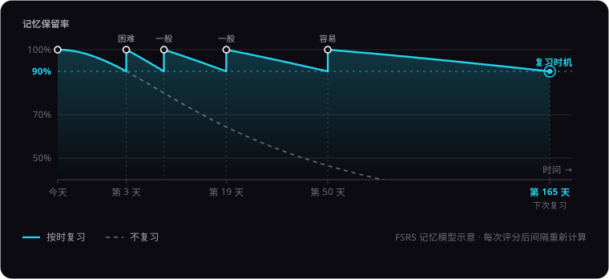

*Solid line: reviewed on time. Each time retention falls to about 90% you review the card, it goes back to 100% and then falls more slowly; four reviews on days 3, 8, 19 and 50, graded Hard, Good, Good and Easy, put the next review on day 165. Dashed line: never reviewed. Real intervals depend on your grades and the retention you set.*

KineX schedules reviews with the open-source **FSRS** algorithm: from your grades it estimates how long you will remember each card and schedules it for around the day you would start to forget. So grade honestly: if you could not recall it, press *Again* (遗忘); a higher grade does not save you work later.

#### The testing effect: recalling beats rereading

**Pulling the answer out of your own memory** strengthens it, more than reading the answer again does: this is the testing effect, also called retrieval practice. Even a failed attempt helps, as long as you try before looking.

Items in KineX are made for this: read the prompt, recall the answer yourself, then click *Show answer* (显示答案). Questions, cloze deletions and image occlusions are all forms of testing.

#### Incremental reading and writing: from SuperMemo

Incremental reading comes from the spaced-repetition program SuperMemo. Instead of reading a book from cover to cover and sorting it out afterwards, you keep many materials in a queue, **read a short part at a time**, pull out what matters and refine it step by step into items, and let the rest slow down or drop. Incremental writing applies the same idea to writing: a piece gets written a little at a time over many sessions.

This is how Topics and Items share the work in KineX: Topics decide “what to read or write next”, Items check “do I remember this?”. See [incremental reading](#incremental-reading) and [incremental writing](#incremental-writing) below for how to do it.

### How effective are common study methods?

In 2013, Dunlosky and four other cognitive and educational psychologists reviewed a large body of research and rated the **utility** of ten common study techniques as high, moderate or low. The ratings weigh whether a technique works across different learners, materials and kinds of tests, and how strong the evidence is.

| Utility | Technique | What it is | How to use it in KineX |
|---|---|---|---|
| **High** | Distributed practice (spacing) | Spread study and review over time | Flashcards follow the FSRS schedule; Topics are read over several sessions |
| **High** | Practice testing | Answer questions, test yourself, recall with flashcards | Make Items; recall before you look at the answer |
| Moderate | Interleaved practice | Mix different kinds of problems or subjects in one session | Review cards from several themes together rather than one theme at a time |
| Moderate | Self-explanation | Explain to yourself why each step or conclusion holds | Write on the board, in your own words, why a step works |
| Moderate | Elaborative interrogation | Keep asking “why is this so?” | Turn the “why” into an Item's prompt, or add question cards on the board |
| Low | Summarization | Write a summary of the material | Board summaries help you think; turn what you must remember into Items |
| Low | Highlighting | Underline or mark key passages | Highlighting is only the first step: follow with *Add to board* or a card |
| Low | The keyword mnemonic | Remember new words through similar-sounding words and images | Only for a few vocabulary items; practise them with image-occlusion Items |
| Low | Imagery use for text learning | Picture what the text describes | Sketch on the board if it helps, but not instead of recall |
| Low | Rereading | Read the material again | Replace passive rereading with incremental reading: read a part, excerpt it |

“Low” does not mean useless: these techniques can still help in particular situations, but the evidence shows limited benefit, or benefit only in some conditions. The most popular ones, highlighting and rereading, score low, while spacing and self-testing score highest. That is why KineX nudges you from a highlight on to a card and a review schedule.

#### Ratings in detail

The paper also rates each technique on five separate questions (its Table 4):

| Technique | Utility | Learners | Materials | Criterion tasks | Implementation | Educational contexts |
|---|---|---|---|---|---|---|
| Practice testing | **High** | ✓? | ✓ | ✓ | ✓ | ✓ |
| Distributed practice | **High** | ✓? | ✓ | ✓? | ✓ | ✓? |
| Interleaved practice | Moderate | ? | △ | ✓? | ✓ | ✓? |
| Self-explanation | Moderate | ✓? | ✓ | ✓? | △ | ? |
| Elaborative interrogation | Moderate | ✓? | ✓ | ? | ✓ | ? |
| Summarization | Low | △ | ✓? | △ | △ | ? |
| Highlighting | Low | △ | △ | ✗ | ✓ | ✗ |
| The keyword mnemonic | Low | △ | △ | △? | △ | △? |
| Imagery use for text learning | Low | △ | △ | △? | ✓ | ? |
| Rereading | Low | ? | ✓ | △? | ✓ | ? |

Key:

- **✓ Positive:** the evidence shows the technique works on this count (P in the paper).
- **△ Qualified:** it works under some conditions or for some groups but not others (Q).
- **✗ Negative:** it is largely ineffective on this count (N).
- **? Insufficient:** there is not enough evidence to judge (I). Two symbols together, such as “✓?”, mean positive overall with insufficient evidence for some factors (P-I, Q-I).
- In *Implementation*, ✓ means it is easy to put into practice without special training; *Educational contexts* asks whether it has been shown to work in real classrooms.

Only practice testing and distributed practice are positive on almost every count. Highlighting, the easiest to do, is negative for criterion tasks and for educational contexts.

> Source: Dunlosky, J., Rawson, K. A., Marsh, E. J., Nathan, M. J., & Willingham, D. T. (2013). Improving Students’ Learning With Effective Learning Techniques: Promising Directions From Cognitive and Educational Psychology. *Psychological Science in the Public Interest*, 14(1), 4–58. [doi:10.1177/1529100612453266](https://doi.org/10.1177/1529100612453266)

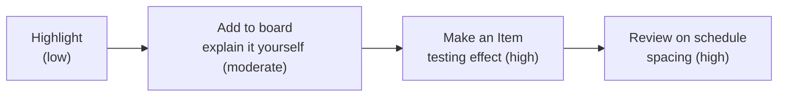

### Two kinds of card

| Type | What it is for | Example |
|---|---|---|
| Topic | Keeps a material or a passage to read, understand and break down later | A lesson, an argument |
| Item | Checks whether you remember a specific piece of knowledge | A question, a cloze deletion, an image occlusion |

A Topic answers “what do I read next?”, an Item “do I remember this?”.

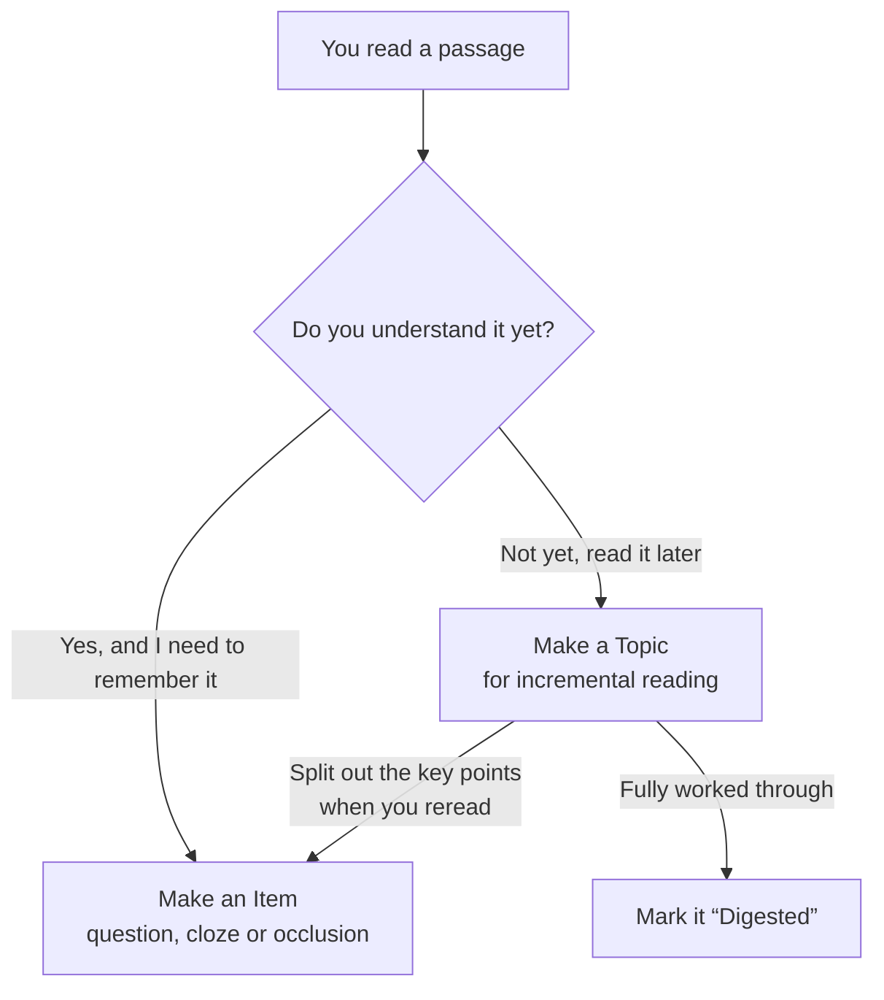

### Making cards from what you read

1. In the reader, switch to the **text** tool and select some text.
2. Next to the selection, choose *Make Topic* (制作 Topic) or *Make Item* (制作 Item); or press Alt+X / Alt+Z.
3. Check the content and the source. For an Item, set the answer to recall or the area to hide.
4. Save it; you will find it in flashcard management.

Selecting text with the highlighter, the pen and similar tools does not offer cards. For an existing highlight or snapshot, click it and make a Topic from its menu.

To put a whole book or a whole video into incremental reading, choose *Add to incremental reading* (加入渐进阅读) in the material's menu. KineX then suggests the first date, or you can choose *Start reading now* (现在开始阅读).

A new card does not necessarily appear in today's queue. To see it now, open it from the management list or use the reading entry offered when you added it.

<a id="incremental-reading"></a>

### Incremental reading: turning a book into cards you remember

Incremental reading suits long material you cannot finish in one sitting and want to really take in.

1. **Queue it.** Choose *Add to incremental reading* in the material's menu: the whole book or video becomes a Topic. You can queue several books at once.
2. **Read a part at a time.** When the Topic is due, read on from where you stopped, as much as you like; there is no need to finish.
3. **Pull out what matters.** Select an important passage in the Topic and use *Extract* (摘录) on the toolbar to make a smaller Topic; for something you understand and must remember, use *Card* (制卡) to make an Item directly.
4. **Grade to set the next time.** After the part, choose *Reread / Want / Normal / Slow* (重读 / 想读 / 一般 / 缓读) to decide when it comes back.
5. **Refine step by step.** Each time a small Topic comes back, trim it further until it fits in an Item or two.
6. **Let go when it is done.** When everything is extracted or no longer needed, mark the Topic *Digested* (已消化; *Finished*, 学完了, for media). It stops coming back; its content and source stay.

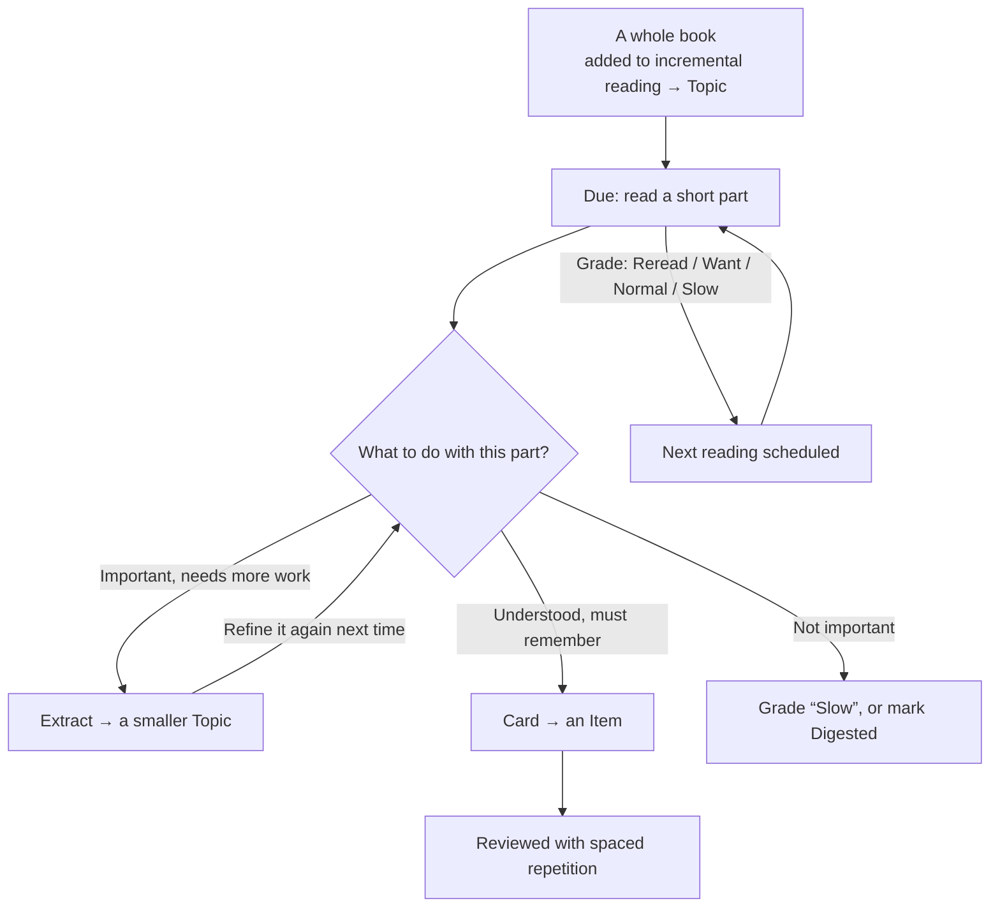

**Priority** decides which cards come first on a given day. Change it with the button showing, for example, “优先 50” in the review area: 0–100, higher comes first. It only affects future scheduling, never your history. With a backlog, give important books a high priority and the rest a lower one. The review settings can also give more important cards a higher retention target.

<a id="incremental-writing"></a>

### Incremental writing: a piece written over many sessions

For reading notes, a review or an essay, switch a text Topic to writing mode and add a little each time it comes up.

1. While reviewing a text Topic, click *Write* (写作) above the card. It becomes a writing Topic and comes back at shorter intervals than a reading Topic.
2. Mark your progress with the stage menu: Draft → Revise → Final (草稿 → 修改 → 定稿).
3. Bring related loose Topics in with *Merge…* (合并…): their text is appended under their titles, the merged Topics are marked Digested, and Items extracted from them keep their original source.
4. When you choose *Final*, either mark it Digested (no more reviews) or turn it back into a reading Topic (it comes back now and then at the “Slow” pace).

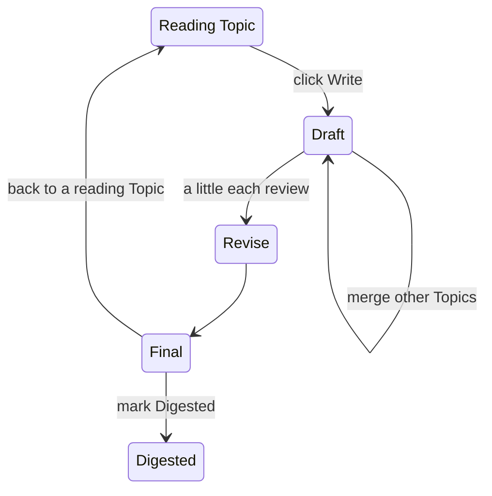

### Daily review

Open *Flashcards* (闪卡) from the top bar. The home page may also show how many cards are due today.

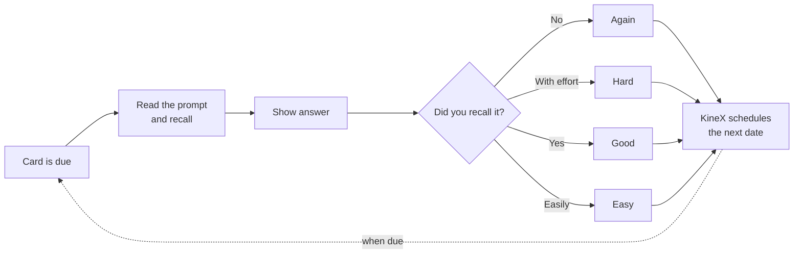

- **Items:** recall first, then click *Show answer*. Grade honestly with *Again / Hard / Good / Easy* (遗忘 / 困难 / 一般 / 容易); under each button is roughly when you will see the card again, such as “in 10 minutes” or “in 3 days”, with the exact date in the button's tooltip.
- **Topics:** after reading, choose *Reread / Want / Normal / Slow* to decide when to continue.
- **Not now:** skip it for this round, or postpone it.
- **Wrong grade:** undo the last grade in the review area; on a touch screen, a two-finger tap also undoes it.

Browsing cards does not change their schedule; only grades given in a review do. When you have fully understood a Topic, mark it *Digested*: it is no longer scheduled, and its content and source stay.

### The review toolbar

Each tool in the review area shows an icon and a short label, such as Edit, Source, Skip, Later, Undo and Exclude. They keep their place from card to card; a tool a card cannot use is greyed out.

Tools that do not fit go into *More*. *More → Adjust toolbar…* lets you drag them into order, choose which stay on the bar, or reset to the default; choose *Icons only* if you do not need the labels. These preferences stay on this device.

### How much to review

The defaults are a good start. If a backlog builds up, first lower the number of new cards per day.

*Retention* is the share of cards you want to still remember when they come up: raise it and reviews come more often, with more work. The forecast workload is an estimate that changes with your grades.

If a card keeps slipping, split it up or rewrite it. KineX's “needs rewriting” hint never deletes or excludes a card for you.

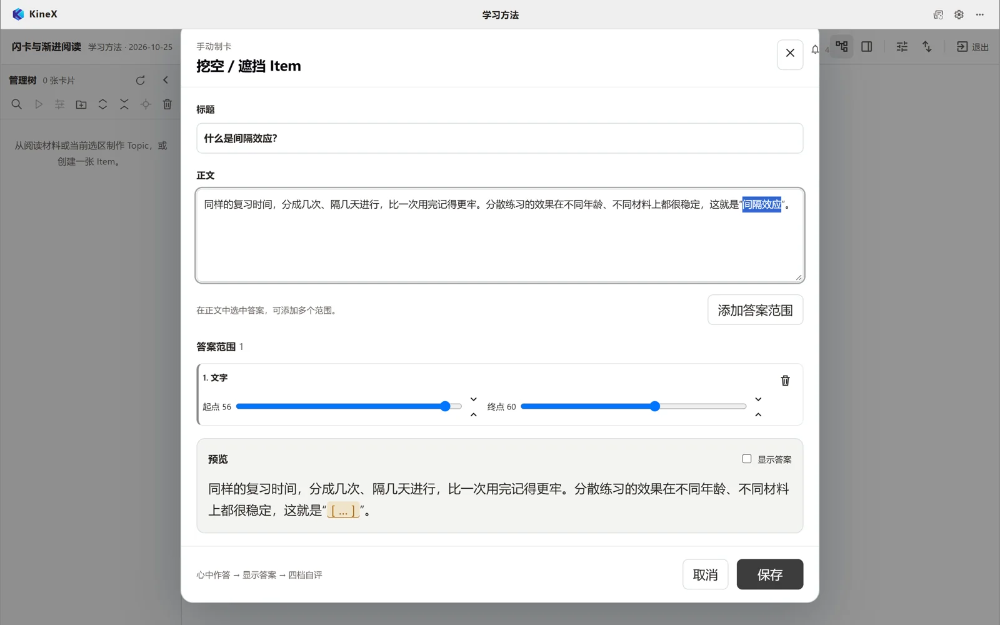

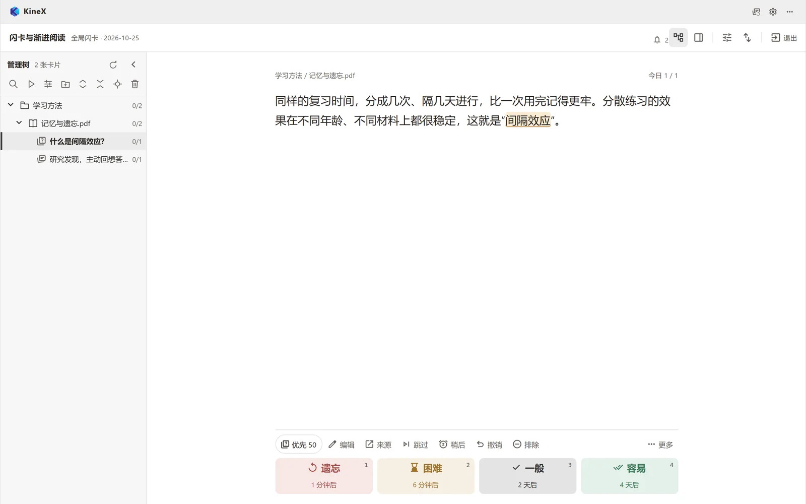

*Top: a cloze Item made from selected text. Bottom: the four grades after showing the answer; the tree on the left holds an Item and a Topic.*

<video controls preload="none" playsinline poster="assets/v03-make-item.jpg" src="assets/v03-make-item.mp4"></video>

*Make an Item from a passage → set the answer and preview → review it early → show the answer → grade it.*

<a id="media"></a>

## 7. Learning from audio and video

### Adding local or online media

Choose a source under the materials “＋” → *Add media source* (添加音视频来源), then open it like any other material.

With OpenList:

1. Add a connection with its name, server address, and the account and password it needs.
2. Click *Test and save* (测试并保存).
3. Browse the folders, tick files or folders, and add your selection.

OpenList media keep their server address and file path, so playing them still needs access to that server. The connection details and any remembered password sync with the library, encrypted; each device keeps its own sign-in.

A multi-part course can go into incremental reading in order. Check the order before you confirm, so file names do not shuffle the lessons.

### The player's two rows

| Row | What it holds |
|---|---|
| Playback | Play / pause, jump (such as ±5s), previous / replay / next sentence (with subtitles), time, speed, volume, on-screen subtitles, audio track, picture-in-picture, full screen |
| Study | Frame grab (*Mark* for audio), excerpt, handwriting; clip, Topic, Item, incremental; marks, chapters, filter |

When the player gets narrow, the study row turns into a grid, and then into icons only. The title row shows the current chapter on the left, such as “3/12 Title”; click it to pick a chapter.

### Subtitles, chapters and finding your place

The player supports subtitles, chapters and marks. Click a subtitle or a chapter to jump to its time; load external subtitles if you need them.

What subtitles can do depends on their format. Image-based subtitles are not selectable text and cannot be turned into text excerpts.

### Keeping a key moment

| To keep… | Use |
|---|---|
| The current frame | Frame grab: straight onto the board, or with a note first, as set |
| The current time | A timestamp excerpt you can come back to |
| A note on the picture | Frame annotation, confirmed when you finish |
| A part to play over and over | Set points A and B and turn on the loop |
| A clip to review | Pick a range or subtitles and make a Topic / Item |

To make a clip card, click the card button once for the start and again for the end, then check the range. An existing A–B range can be used directly; you can also select subtitles and make a card from them.

A clip Item needs subtitles in the range, or a supported way to hide part of the picture. A saved card can play its source clip, so you can check it during review.

Frame annotations never change the video file. A–B ranges are kept on this device and do not sync with the theme.

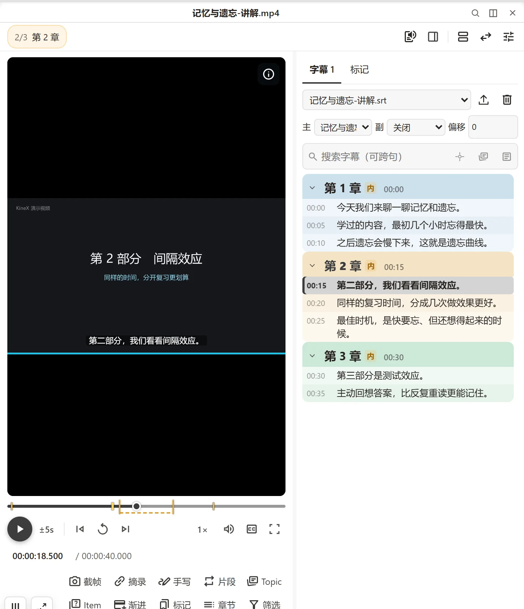

*The player: on-screen subtitles, the subtitle list grouped by chapter, an A–B range on the timeline, and the study row.*

<a id="read-aloud"></a>

## 8. Read-aloud and listening

*Read aloud* (朗读) speaks text materials; *listen* (听读) plays a media material's own sound. Open audio or video and click *Listen* on the player; with subtitles you can step through and excerpt them sentence by sentence.

### Starting read-aloud

1. Open a readable PDF, EPUB, TXT, Markdown or web material.
2. Click *Read aloud* on the reader toolbar: it starts at the first sentence on screen, or at the text you selected.
3. Use the playback bar to pause, move between sentences, repeat a sentence or change the speed.
4. When you hear something important, click *Excerpt sentence* or *Excerpt paragraph* to keep it on the board.

The current sentence can be highlighted and followed. You can look elsewhere for a while and then click *Back to reading position*. A sleep timer stops after a time or at the end of a part.

A PDF needs extractable text: scanned pages without a text layer cannot be read aloud.

### Choosing a voice

Open *Settings → Read aloud* (设置 → 朗读), pick an engine and a voice, and click *Try*. By default KineX uses the device's system voices.

KineX does not ship third-party speech engines or voice packs. For other voices, set up your own speech service and add it as a *read-aloud interface* (朗读接口).

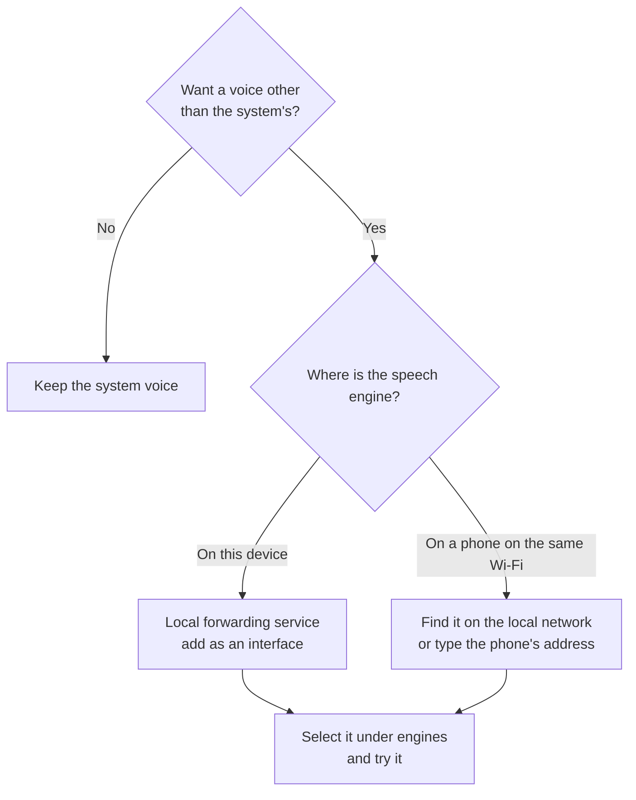

### Adding an interface on this device

For a speech engine you have installed that offers a “forwarding service”.

1. Install its voices as the engine describes and turn on its forwarding service.
2. In KineX, *Settings → Read aloud*, find *Local forwarding service* (本机转发服务) and click *Add as interface* (加为朗读接口).
3. If it is not found, click *Add interface…* (添加朗读接口…) and type the address the engine shows, such as `http://127.0.0.1:8774`. Use the port set in the engine.
4. Select it under the read-aloud engines and try it.

### Using your phone's voice on your computer

1. Connect the phone and the computer to the same Wi-Fi, with the phone's forwarding service on.
2. On the computer, open *Settings → Read aloud* and click *Find on local network* (在局域网里找).
3. If nothing is found, type the local address the phone shows, such as `http://192.168.1.23:8774`.
4. Select that interface and try it.

On the computer, `127.0.0.1` means the computer itself and cannot reach the phone. To use the phone's voice, give the phone's local address.

An interface receives the text it reads, so only use addresses you trust. Using a phone, locked for long periods, purely as the computer's voice server has not been fully tested yet.

### Pronunciation dictionary and cache

- **Pronunciation dictionary:** in *Settings → Read aloud → What to read* (朗读内容), set how names, words with several readings or terms are spoken. It changes the reading only, never the text, and its entries sync with the library.
- **Read-aloud cache:** sound made by an interface is kept on this device and reused when you listen again. Manage its size or clear it in the read-aloud settings; the cache is not backed up or synced, and system voices do not use it.

### Mini window and lock screen

The desktop app can pop the playback bar out into a *mini window* (弹出小窗), so you can listen while doing something else. The Android app plays in the background with lock-screen controls; whether it shows its own lock-screen page is a setting.

In a browser, read-aloud is subject to the browser's background rules, so it may stop when the screen locks.

If KineX and the forwarding engine run on the same Samsung device and pauses appear between sentences with the screen off, try turning off the engine's “prevent sleep” option. This may not apply when the phone only provides the voice for a computer.

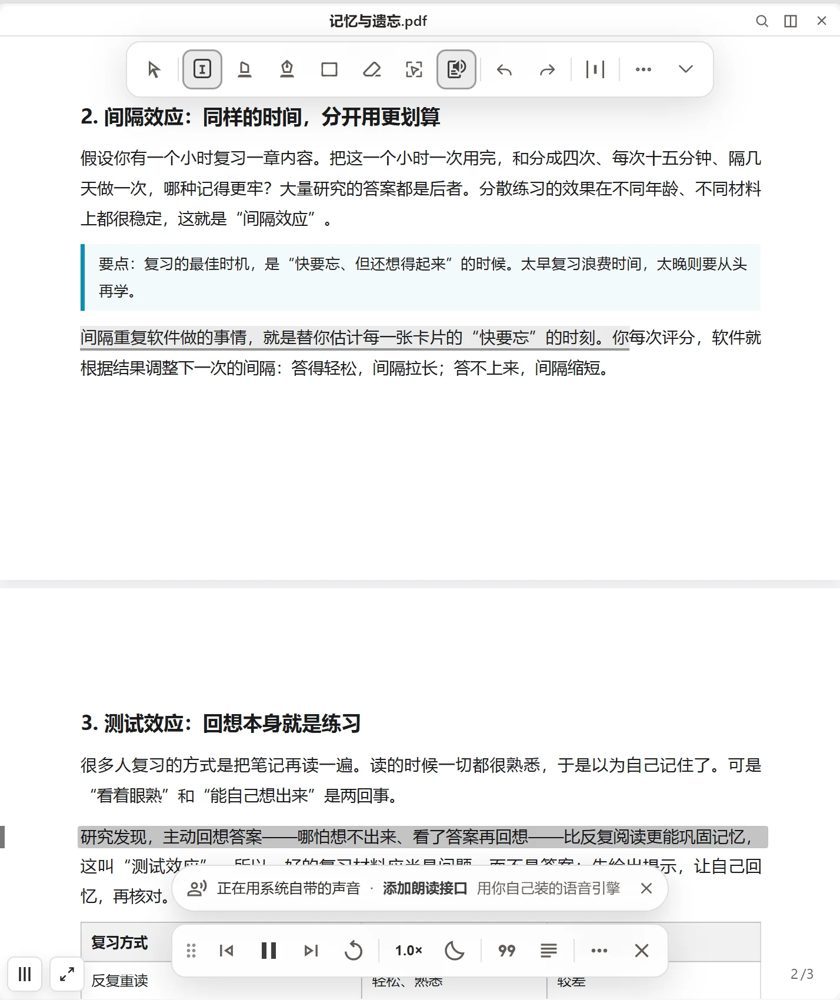

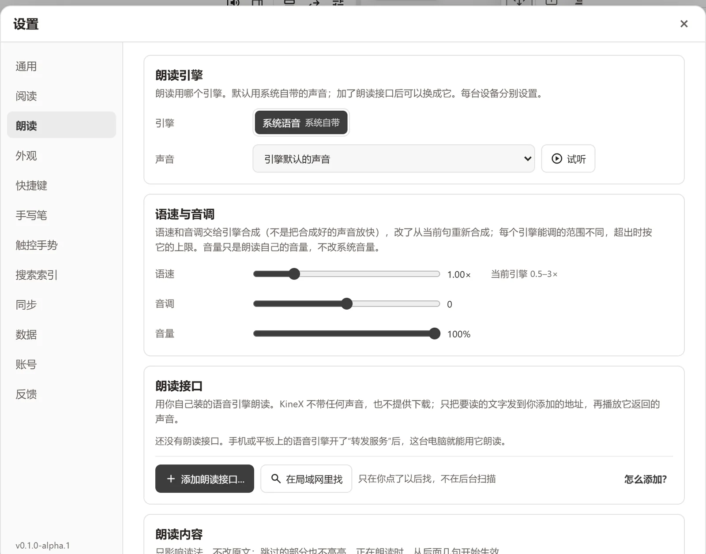

*Top: the sentence being read is underlined, with the playback bar at the bottom. Bottom: Settings › Read aloud.*

<video controls preload="none" playsinline poster="assets/v04-read-aloud.jpg" src="assets/v04-read-aloud.mp4"></video>

*Reading a PDF aloud with the voice engine on a tablet → next sentence → excerpt it to the board.*

<a id="recording"></a>

## 9. Recordings linked to notes

The recording entry is in the theme workspace's top bar or under “⋯”. KineX asks for the microphone only when you start recording.

1. Open the recording window and pick an input.
2. Start recording, and take notes on the board or the PDF as you go.
3. Add a bookmark at important moments, or select something and link it to the current time by hand.
4. Stop recording and wait for it to finish saving.

While recording, supported note actions are linked to the recording time automatically. Select such a note and use *Play linked recording* (播放关联录音) to hear it from just before you wrote it. Links you added by hand are listed in the recording's links.

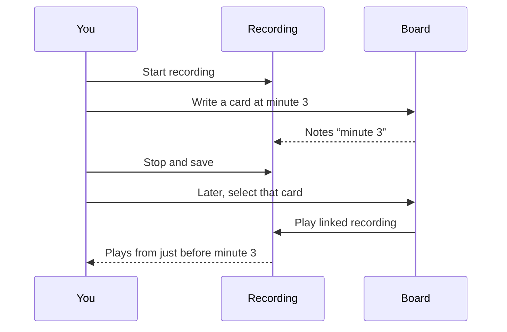

Closing the recording window does not stop the recording. In a browser, recording pauses when the page goes to the background, and you resume it by hand when you come back; check how your platform behaves before a long recording.

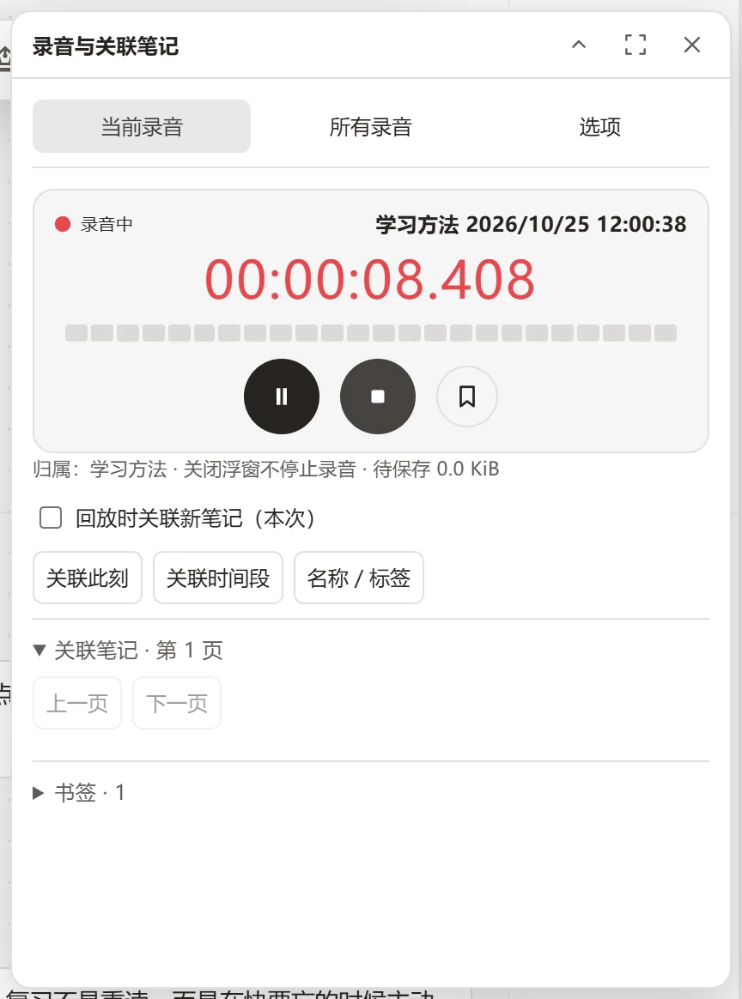

*Recording: add bookmarks, or link the selected note to this moment.*

<a id="search"></a>

## 10. Search and favourites

### Finding things in a material or the whole library

| Where | How |
|---|---|
| The current material or board | Click it, then press Ctrl+F |
| The whole library | Ctrl+Shift+F, or “⋯” → *Global search* (全局搜索) in the top bar |

Start with plain keywords and narrow the scope as needed. Search understands quoted phrases, several words that must all match, excluded words and similar.

Full-text search needs its index; see progress in *Settings → Search index* (设置 → 搜索索引). If nothing turns up, check the scope and the index progress. Search does not run text recognition on scanned pages or transcribe audio and video.

### Two kinds of favourite

- **Favourite themes:** favourite a whole theme on the home page to get back to it quickly.
- **Board favourites:** select cards or ink and click the star in the selection bar to keep them in your global favourites; drag them onto another board later.

Global favourites can be filtered by source, type, category and rating. If a favourite is missing, clear the filters you do not need.

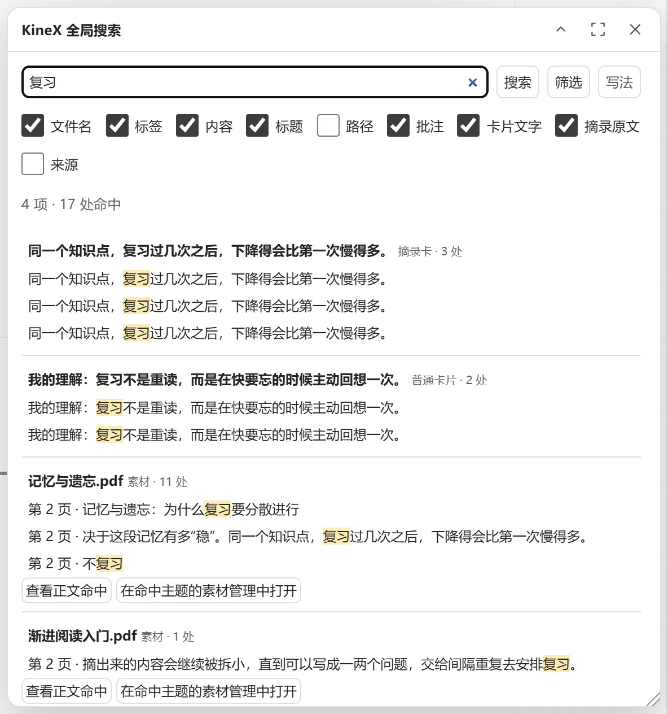

*Global search for “复习” (review): results in cards, annotations and material text.*

<a id="learning"></a>

## 11. Study statistics and points

Open *Study statistics* (学习统计) from *Today's study* on the home page or from the top bar to see your reading, organising and review time. Each has its colour: reading follows the current colour scheme, organising is teal, review is amber.

The calendar shows each day's time and when you studied; the charts show your recent habits. A daily time goal or a weekly books-finished goal helps set a rhythm.

Study time follows what you are actually doing; it does not count just because KineX is open. If a number looks wrong, read the timing notes on the page.

### Points, tasks and rewards

Rewards are optional and do not affect reading or review.

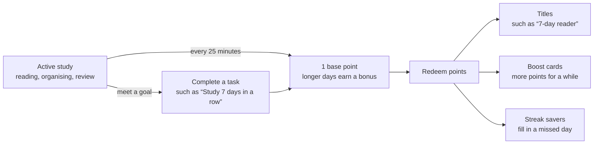

- **Tasks** say plainly what they ask, such as “Study 7 days in a row” or “Study 100 hours in total”. A “study day” means at least 25 minutes of active study that day.
- **Under 25 minutes** carries over to the next day and counts once a full batch is reached.
- **How points are calculated** can be expanded on the page.

With the library synced, study records add up across your devices.

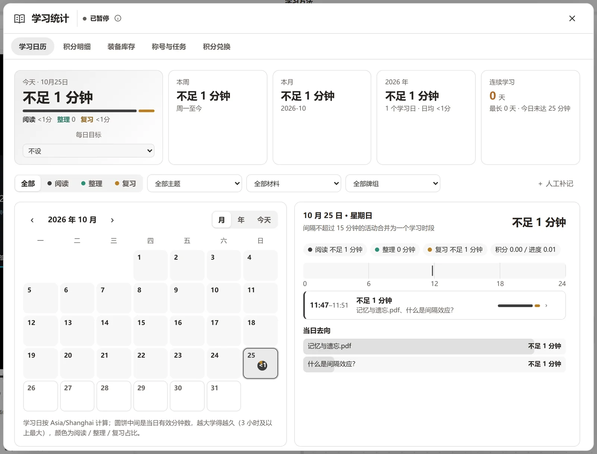

*Study statistics: calendar, the day’s timeline and progress.*

<a id="sync"></a>

## 12. Library and sync across devices

### Saved on this device, and the library folder

Everything you do is saved on this device automatically. Cloud sync is set up separately.

On desktops that support a library folder, choose a local folder when asked the first time, or later in *Settings → Data* (设置 → 数据). Materials are filed by theme, easy to find in your file manager.

- `Themes/`: materials and readable copies of notes, by theme.
- `Flashcards/`: readable copies of flashcards.
- `.kinex/`: what KineX needs to run the library; do not change it by hand.

The readable copies of notes and flashcards are for looking at outside KineX; editing them does not change KineX. Copying only these files is not a full backup.

Choose a local folder, not one inside OneDrive, Dropbox or another folder that a cloud drive syncs live. To use KineX on several devices, set up KineX's own sync.

On the desktop you can create, open and switch between several libraries; each keeps its own data and sync connection. Phones and tablets use one library for now.

### Choosing how to sync

Sync is set up in *Settings → Sync* (设置 → 同步). KineX has no public cloud: your data lives on your own server or storage, encrypted with your sync key before it is uploaded, so the server cannot read it.

| Type | When it fits | How fast changes reach another device |
|---|---|---|
| KineX Sync, real time (KineX 同步服务) | You have a NAS or a server and can run a Docker container | Almost immediately while the other device is online |
| S3 (MinIO, R2, OSS…) | You already have object storage | With automatic sync, usually tens of seconds or more |
| WebDAV | You already have a WebDAV drive or a NAS folder | Same as S3 |

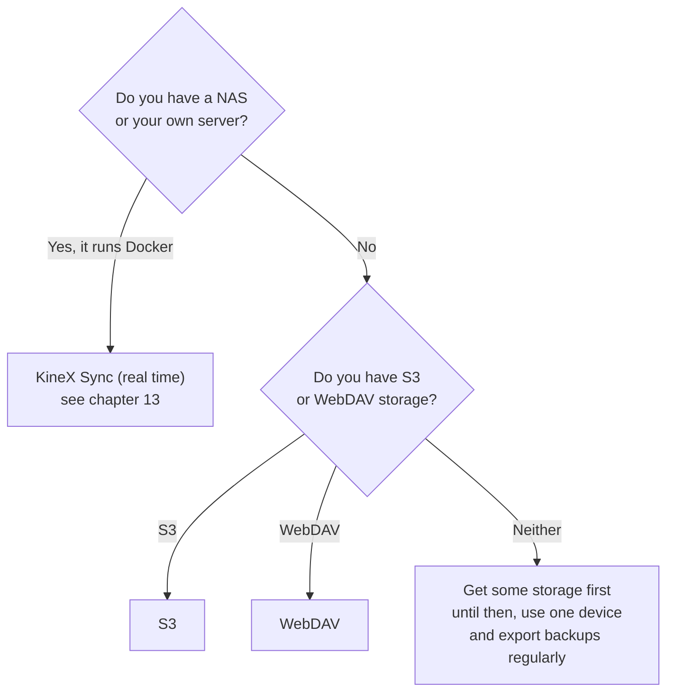

S3 and WebDAV accept `http://` only for local-network or local addresses; use `https://` for anything on the internet, so your storage credentials are not exposed.

### Keys and accounts: which is which

| Name | What it is | Where it goes | If you lose it |
|---|---|---|---|
| Sync key | A line starting with `KX2-` that encrypts and unlocks your cloud data | Settings → Sync; the same line on every device | New devices cannot open the existing cloud data: keep a copy |
| Storage credentials | S3 access keys, or a WebDAV user name and password | Settings → Sync (S3 / WebDAV) | Get them again from the storage provider |
| KineX Sync account | The login name and password an administrator created on your KineX Sync server | Settings → Sync (KineX Sync) | Ask the administrator to reset the password |
| KineX account | Signs in with an e-mail code; used for activation codes, online checks and feedback; holds no notes | Settings → Account | Sign in again with the same e-mail |

### First device: setting up sync

1. Open *Settings → Sync* and choose a type.
2. Fill in the connection:
   - S3 / WebDAV: the address and credentials from your storage provider, then *Save and test* (保存并测试);
   - KineX Sync: server address, account, password and a name for this device, then *Sign in and test* (登录并测试).
3. Choose *This is the first device: generate a key* (这是第一台设备：生成密钥).
4. Keep the sync key somewhere outside KineX, such as a password manager, tick *I have saved this key* (我已保存这行密钥), then start syncing.
5. Wait for the first upload to finish and check the sync status.

The sync key unlocks your cloud data; it is not the password of your storage or sync account. You need it to add devices, and without it a new device cannot open the existing cloud data. To see it again later, use *Show key (to add devices)* (显示密钥).

### Other devices: joining the library

1. Use an empty library; if the device already has its own data, back it up and sort it out separately first.
2. Fill in the same sync target as on the first device and test the connection.
3. Choose *I have a key: join the library* (已有密钥：加入资料库) and paste the same key.
4. Click *Join and download* (加入并下载), and wait for it to finish or reopen KineX when asked.

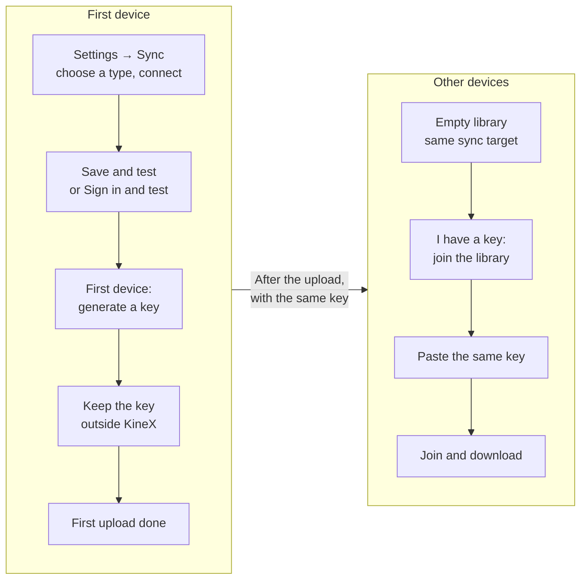

Each device has its own connection and sync key setting. Do not generate a new key on a new device.

### Everyday sync

The *Library sync* window (资料库同步) syncs now and shows problems; connection, key and advanced actions are in Settings.

| Sync mode | When it syncs | Available with |
|---|---|---|
| Real time | Changes go to other online devices at once; offline changes wait on this device and catch up when you reconnect | KineX Sync |
| Automatic | When idle after a change; once more when you leave or close KineX if something has not synced | S3 / WebDAV |
| Manual (once at start and close) | Once when KineX opens, once more on close or going to the background if something changed; sync by hand in between | S3 / WebDAV |
| Manual / fully manual | Only when you click *Sync now* | All types |

Before switching devices, make sure this one has finished syncing. Force-quitting the app is not a reliable sync on close.

With S3 or WebDAV, trusted devices of the same library can speed up transfers over the local network (*LAN sync acceleration*); the cloud still stores and coordinates the library.

### What comes along?

Themes, boards, materials kept in the library, annotations, flashcards, study records, reading positions, tags, the pronunciation dictionary, OpenList connections and some common settings sync with the library.

Device settings such as window positions, split layouts, file access permissions, review toolbar preferences and dismissed announcements usually stay on each device. Read-aloud interfaces and voices are set per device and the read-aloud cache does not sync; linked local media files are not uploaded by sync.

### When there is a conflict

Different changes from two devices are merged where possible. When the same thing was changed in ways that cannot be reconciled, the sync centre shows *Needs your decision* (需要你决定).

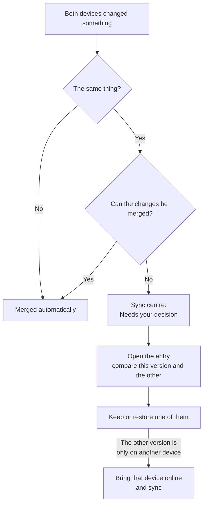

Open the entry, look at the current content and the other version, then keep or restore one. Some choices must be made on the device that holds the other version: bring that device online and sync.

With KineX Sync, changes from devices that are both online are put in order in real time, so conflicts are rare; if both sides changed the same thing while offline, handle it as above.

For everyday use, just sync. *Replace this device with the cloud* and *Replace the cloud with this device* change which copy wins; use them only when you know exactly why.

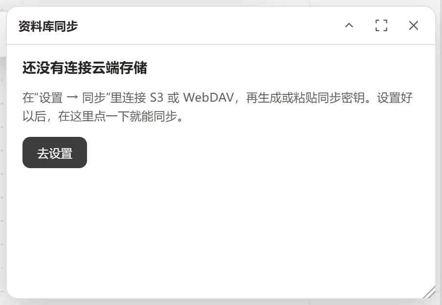

*The library sync window: with no cloud storage yet, click 去设置 (Set up).*

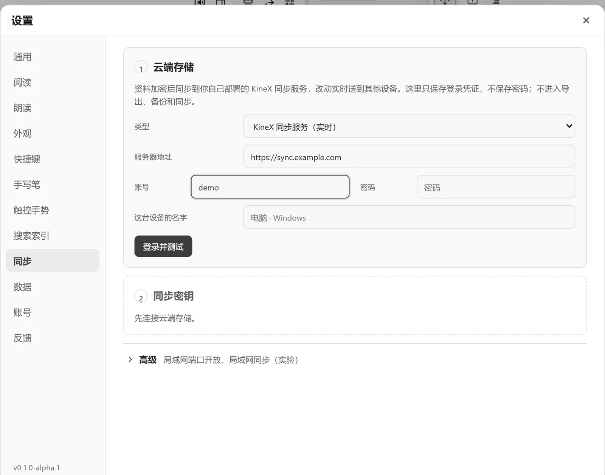

*Settings › Sync with the type KineX Sync (real time); the address is an example.*

<a id="self-hosted-sync"></a>

## 13. Self-hosting KineX Sync

KineX Sync (kinex-sync) is a real-time sync server you run yourself. It comes as a Docker container for fnOS, Synology or any Linux host.

- **Real time:** when one device changes something, the others online receive it almost at once, with far fewer conflicts than S3 / WebDAV.
- **Several accounts:** give each family member an account; their libraries are separate.
- **Encrypted data only:** the sync key stays on your devices; neither the administrator nor the server can read your notes.
- **Admin panel included:** create accounts, set space limits, remove devices and schedule backups in a web page.

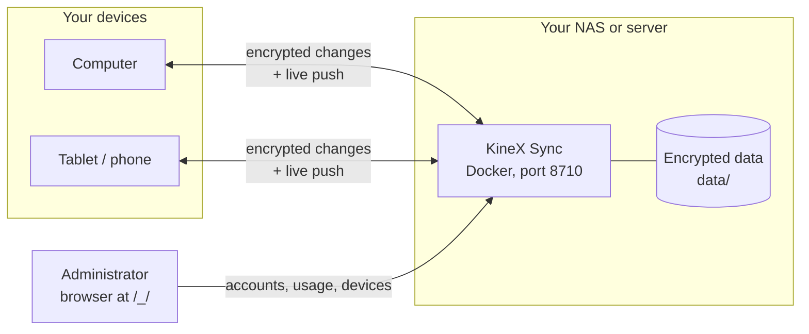

### Before you start

| You need | Notes |
|---|---|
| An always-on machine | A NAS or Linux host with Docker; x86-64 or ARM64 |
| The deployment files | `Dockerfile`, `compose.yml`, the program for your architecture and a certificate file; where to download them will be announced with the release |
| A port | 8710 by default, reachable on your local network |
| https (for Android) | The Android app only allows encrypted connections; the desktop app can use a local `http://` address |

### Deploying (fnOS as the example)

1. Create a folder in your storage, such as `docker/kinex-sync`, and put the deployment files in it. On ARM, use the ARM64 program and change the architecture in `compose.yml` as described.
2. Set `user:` in `compose.yml` to your user and group IDs on the NAS (run `id` over SSH to see them), so the data files belong to you and are easy to back up.
3. Open fnOS Docker → Compose → new project, choose this folder and start it. The image is built on the NAS; nothing is pulled from the internet.
4. Open `http://<NAS address>:8710/_/` in a browser: the admin panel means it is running.

### First: create the administrator

Either:

- Open the container log (fnOS Docker → Containers → kinex-sync → Logs), find the link ending in `/_/#/pbinstal/`, replace `0.0.0.0` in it with the NAS address, open it and set the administrator's e-mail and password. If the link has expired, restart the container to get a new one.
- Or run this over SSH (with your own e-mail and password):

```bash
docker exec kinex-sync /kinex-sync superuser upsert you@example.com your-password --dir /data
```

The administrator only signs in to the admin panel; it is not a sync account.

### Sync accounts for you and your family

The admin panel is in English.

| To… | Where |
|---|---|
| Create a sync account | Collections → users → New record: `username` (the login name) and `password`; `email` is optional |
| Change a space limit | users → open the account → `quotaGB` (0 means the default) |
| Suspend an account | users → tick `suspended`: no sign-in or sync, data kept |
| See usage | users: `usedGB`; libraries: size, entries and last change |
| Remove a lost device | Collections → devices → find it → tick `revoked`: it disconnects at once and cannot sync again |
| Delete a cloud library you no longer need | Collections → libraries → delete: only the server's copy goes; devices keep their data |
| Scheduled backups | Settings → Backups: on a schedule, optionally to S3 |

### Connecting from KineX

1. Open *Settings → Sync* and choose the type *KineX Sync (real time)* (KineX 同步服务（实时）).
2. Fill in the server address (such as `http://192.168.1.2:8710` or your `https://` domain), account, password and a name for this device.
3. Click *Sign in and test*. The password is used for this sign-in only; the device keeps a sign-in token.
4. On the first device choose *This is the first device: generate a key*; on the others, *I have a key: join the library* and paste the same key. Then continue as in [chapter 12](#sync).

Once connected, the sync settings show the account, server and space used; the library sync window says “Real-time sync · KineX Sync · Online: …”. There are two sync modes: real time and manual.

*Sign out* in the settings stops sync on this device; the server's data and other devices are not affected.

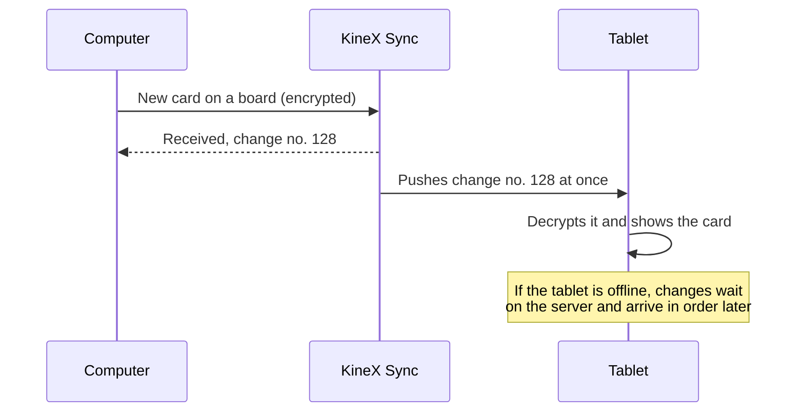

### https and access from outside

The Android app needs an `https://` address. The desktop app and devices on your local network can use `http://<NAS address>:8710`. With a reverse proxy set up, computers and Android devices can all connect from anywhere through the same `https://` address.

- **With a domain:** point it at `http://127.0.0.1:8710` in fnOS's reverse proxy (or Caddy, Nginx, Lucky) and:
  - turn on WebSocket / SSE support with a read timeout of at least 6 minutes (live push uses a long connection);
  - do not turn on compression buffering for `/api/`, which delays pushes;
  - allow uploads of at least 32 MB.
- **Without a public IP:** a mesh VPN such as Tailscale can get a proper certificate for a private address.

### Backup and upgrades

- **Backup:** use Backups in the admin panel, or stop the container and copy the whole `data/` folder. The data is encrypted, but it includes the account password hashes, so keep backups safe.
- **Upgrade:** replace the program file, then rebuild and start (`docker compose up -d --build`). The database is upgraded on start.

A server backup does not replace KineX's own export: it holds encrypted data that only your sync key can open.

### Current limits

- With real-time sync, *Replace this device with the cloud* is not available yet, and the actions to disable, clear or reclaim cloud space are not shown.
- There is no guided switch from S3 / WebDAV to KineX Sync yet. Before switching, let every device finish syncing the old way and keep a full backup; then change the type in Settings, generate a key on the first device and join the others with it.

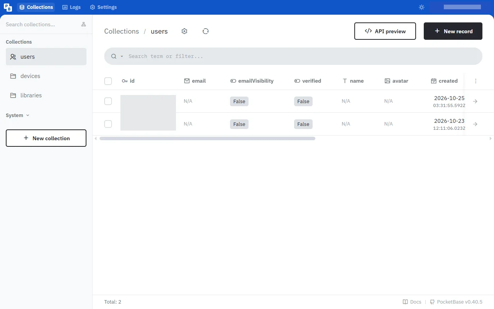

*The kinex-sync admin panel’s users list (e-mail and ids masked).*

<video controls preload="none" playsinline poster="assets/v06-realtime-sync.jpg" src="assets/v06-realtime-sync.mp4"></video>

*Two devices on the same KineX Sync: a card written on A appears on B right away.*

<a id="backup"></a>

## 14. Export, backup and restore

### Pick the right tool

| To… | Choose |
|---|---|
| Share notes, or move them to another notes app | Content export, such as Markdown |
| Keep the layout to print or send to someone | PDF or image export |
| Keep a complete theme you can import again | A `.kinex` theme package |
| Keep editing on several devices | Library sync |
| Get earlier content back | Data history, or a full backup you already have |

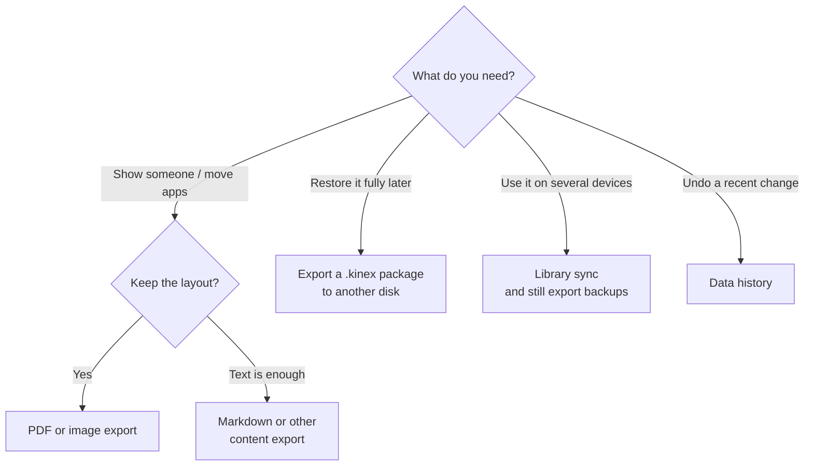

Sync spreads changes and deletions too, so keep separate backups. Markdown, PDF and images are for reading and sharing; they cannot bring back everything you can edit.

### Exporting a board

Use the export entry in the board's top-right menu and choose the range and format.

For PDF or paged images, *Avoid cutting* (避开切断) moves whole cards and groups to the next page where it can; *Along print lines* (沿印刷线) cuts the layout as it is, so the pages can be put together. Check the preview before exporting.

### Backing up a whole theme

Export a theme from its menu on the home page, or with *Export data* (导出数据) in the theme's *Settings → Data → Local data and export* (本地数据与导出), and keep the `.kinex` file somewhere separate.

Keep the exported file and refresh it regularly; do not rely on a single copy on the same disk.

### Importing or merging

After choosing a file in *Local data and export*, check the preview first: source theme, export time, data size and warnings.

- **Import data:** replaces the current theme with the package's data.
- **Merge data:** merges the package's content into the current theme.

Make sure the right theme is open before you confirm. Before replacing or merging, KineX keeps a protective copy on this device under *Backups before restore* (恢复前备份); these copies do not sync to other devices.

### Data history

To bring the library back to an earlier state, look through the versions in *Data history* (数据历史) and restore one after confirming what it covers. Save anything important first.

Data history keeps versions in tiers: recent ones close together, older ones further apart. Each version shows its time, source, full size, and the space it adds and would free; more is under *Technical details*. On a phone, versions are listed first; tap one for its details and *Back* at the top left returns to the list.

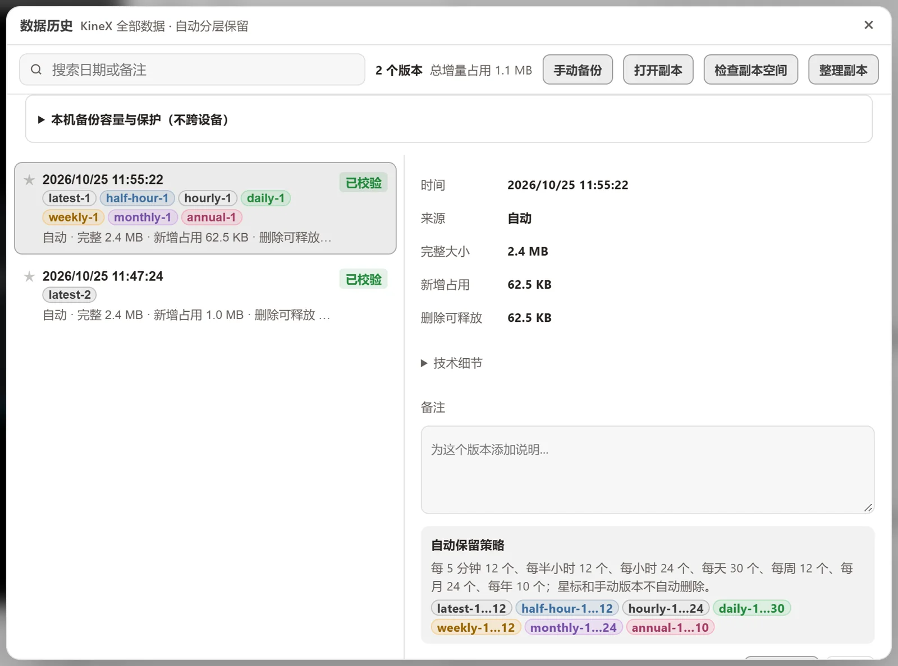

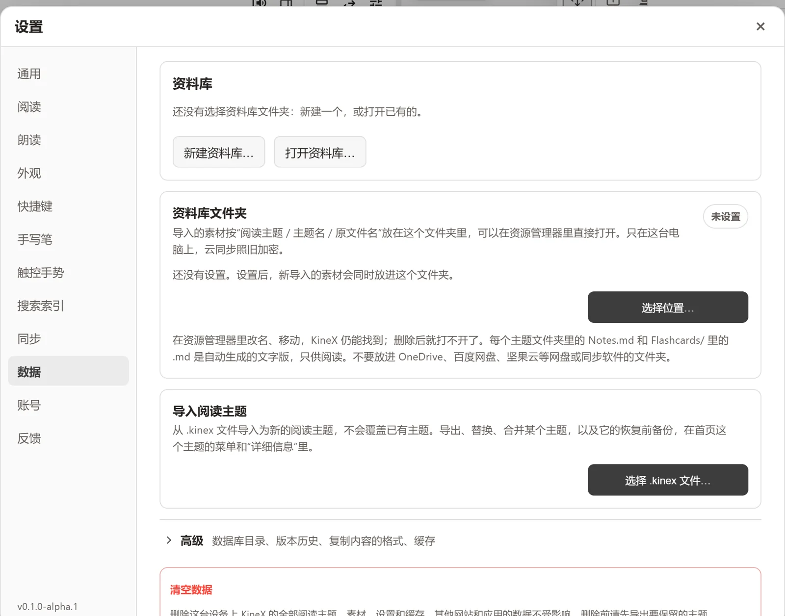

*Top: data history. Bottom: Settings › Data.*

<a id="account"></a>

## 15. Your KineX account and activation codes

Your KineX account confirms that this device can use every feature, redeems activation codes and lets you send feedback. It **does not hold your notes**: those stay on your devices and in the sync storage you set up.

The account is in *Settings → Account* (设置 → 账号); builds without the account service do not show this page.

### Signing in

KineX signs you in with your e-mail, no password.

1. Open *Settings → Account*, type your e-mail and click *Get code* (获取验证码). The button briefly says it is sending while KineX completes a quick security check in the background, usually in under a second.
2. Type the 6-digit code from the e-mail.
3. The first time you use an e-mail, accept the Terms of Service and Privacy Policy, and that your account details (e-mail, devices) are stored on servers outside mainland China, then click *Agree and sign in* (同意并登录).
4. If the account already has five devices, the page lists them: sign one out, then sign in on this device.

If you mistype the code, the page says how many tries are left; an expired code is simply requested again. After too many attempts, wait an hour.

### What the account page shows

| Item | Notes |
|---|---|
| E-mail | Partly masked |
| Status | Such as “All features · until <date>”, “All features · permanent” or “All features · beta until <date>”; with nothing active yet, “Account not activated yet” |
| Devices (n/5) | Up to five devices per account. Sign out other devices here; the page shows how many more you can sign out this year |
| Activation code | Type it and click *Redeem* (兑换) |
| At the bottom | Sign out · Export account data · Delete account |

### Redeeming an activation code

Type the code under *Activation code* and click *Redeem*; case and spaces do not matter.

| Code | Effect |
|---|---|
| Fixed term (such as 1 month, 3 months, 1 year) | Calendar months: one month redeemed on 31 January runs to 28 February (29 in a leap year) |
| Permanent | Never expires |

Several fixed-term codes **follow one another**, so none is wasted by overlapping. A fixed-term code redeemed during the public beta starts only when the beta ends, and the account page shows an extra line saying when it starts and ends.

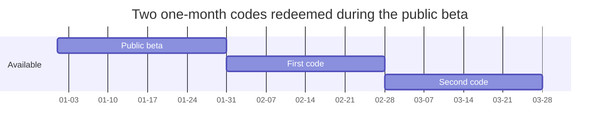

*The dates are only an example: the beta runs to 31 January and the two codes follow it in turn.*

If redeeming fails, the page says why: the code is wrong, already used, expired or disabled.

### Regular online checks

Once you are signed in, each device renews itself once a day when it is online; each renewal lasts 14 days.

- As long as one device on the account goes online often, it renews the others too, and library sync carries that renewal across. For example, a tablet that only syncs on the home network stays active while the computer goes online every day.
- When renewal is due within three days, a quiet note in the bottom-right corner says the device needs to go online once and will then renew itself; *Settings → General* also shows the last check with *Check now*.
- Past the deadline without going online, some features say to connect to the network to continue; they come back by themselves once online.

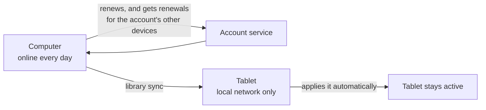

The features that need the online check are sync, pens other than the gel pen, audio and video, read-aloud and listening, flashcards, web import, recording, and paged PDF and image export. While one is unavailable:

- your materials, cards and recordings are never changed or deleted;
- a player already open, or a reading already under way, is not cut off;
- Markdown and other content exports keep working.

The exact list follows the app and the arrangements announced for the full release.

### Signing out and deleting the account

- **Sign out:** signs out straight away; your data on the device is untouched and comes back when you sign in again. If another device signs this one out, or the account is deleted, this device signs out by itself.
- **Export account data:** downloads the account's records, including devices and feedback.
- **Delete account:** confirmed with an e-mail code. The account and its device records are deleted and any redeemed codes stop working; this cannot be undone. Data on your devices is not affected. Public suggestions you posted stay, without your name.

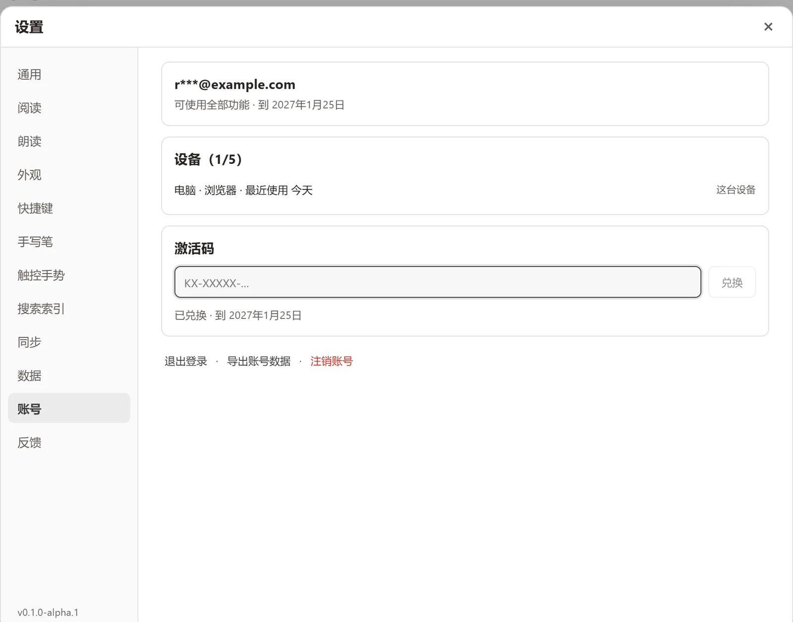

*Settings › Account after redeeming an activation code.*

<video controls preload="none" playsinline poster="assets/v07-account.jpg" src="assets/v07-account.mp4"></video>

*Sign in with an e-mail code → accept the terms → redeem a code → the status changes to all features.*

<a id="feedback"></a>

## 16. Feedback and the roadmap

Tell the developer about a problem or a feature you want, in the app or on the website, and see what KineX is working on next.

### Feedback in the app

Open *Settings → Feedback* (设置 → 反馈). Without signing in you can browse public suggestions; to post or vote, sign in to your KineX account.

| Entry | Use |
|---|---|
| Report a problem (报告问题) | Give a title and what happened. *Attach version and device* is ticked by default; *Attach recent errors* can be checked with *View* before you decide. Only you and the developer can see problem reports |
| Suggest (提建议) | Similar suggestions appear as you type the title; if yours is there, just vote. Your first suggestion asks for a nickname and how to show it: in full, first character only, or anonymous. Suggestions are public after review |
| My feedback (我的反馈) | Your reports and suggestions, and how they are going |
| Public suggestions (公开建议) | Browse by *Popular / New* and vote for what you want |
| Nickname and notifications | Change your nickname and how it shows; e-mail me when my feedback moves |
| See the roadmap → | Opens the roadmap on the website |

Each suggestion shows official replies and its progress; you can add a comment, or turn on e-mails when it moves. To prevent flooding, each person can post at most 5 times an hour and 10 a day.

### What happens to feedback

**Suggestions:**

```mermaid
stateDiagram-v2
    state "Under review" as pending
    state "Not approved" as rejected
    state "Received" as open
    state "Planned" as planned
    state "In progress" as started
    state "Done" as completed
    state "Not planned" as declined
    state "Duplicate (merged)" as duplicate
    [*] --> pending: posted
    pending --> open: approved and public
    pending --> rejected
    open --> planned
    planned --> started
    started --> completed
    open --> declined
    open --> duplicate: votes and followers move over
```

**Problem reports:**

```mermaid
stateDiagram-v2
    state "Received" as open
    state "Working on it" as started
    state "Fixed (with version)" as completed
    state "Cannot reproduce" as cannot
    state "Duplicate" as duplicate
    [*] --> open: reported
    open --> started
    started --> completed
    open --> cannot
    open --> duplicate
```

When a status changes or there is an official reply, everyone following that item gets an e-mail, at most one summary a day per person; the unsubscribe link in it stops one item or all of them.

### Updates on the website

Click *Updates* at the top of [kinexnote.com](https://kinexnote.com/updates/) for three tabs:

| Tab | What it shows |
|---|---|
| Roadmap | A board with Planned, In progress and Done, filtered by area (reading, board, flashcards and study, sync, tablet, other); open a card to see the suggestions behind it |
| Changelog | New features, improvements and fixes in each version, by year and version on the left; the latest version links to its download |
| Suggestions | The same as the app's public suggestions; sign in on the website to suggest, report problems and vote |

The website also signs you in with an e-mail code and keeps you signed in for 30 days. Done items stay on the roadmap for 90 days.

```mermaid
flowchart LR
    A["You suggest something"] --> B["Public after review"]
    B --> C["People vote"]
    C --> D["The developer adds it<br/>to the roadmap"]
    D --> E["In progress → Done"]
    E --> F["In the changelog<br/>followers get an e-mail"]
```

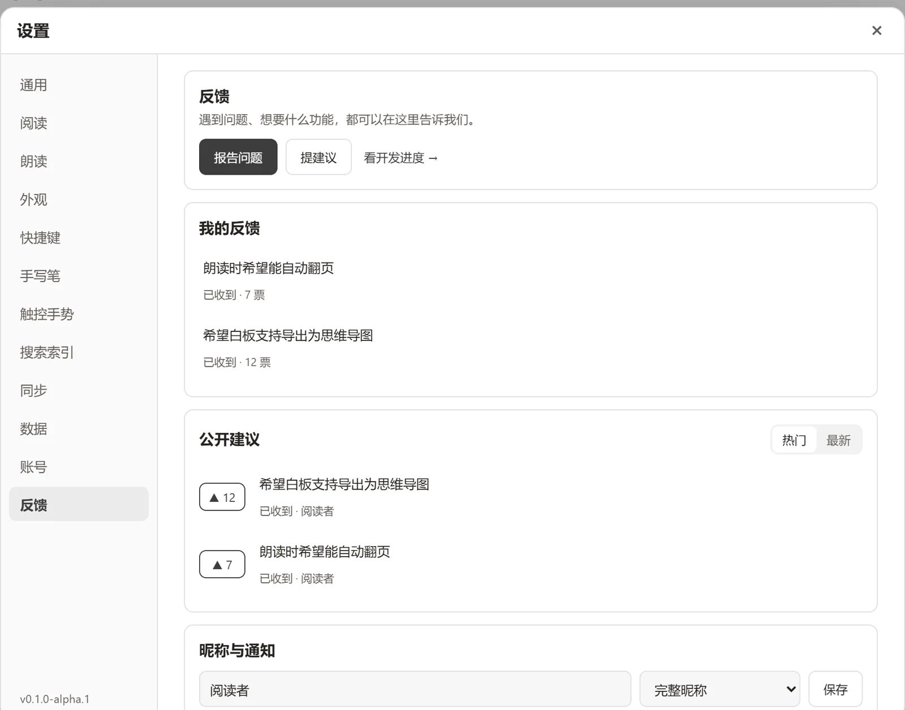

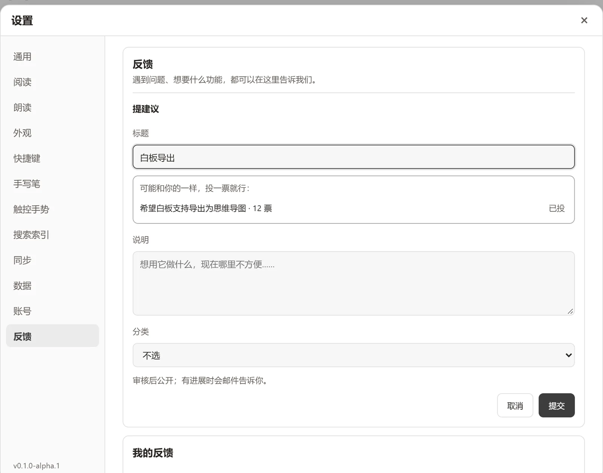

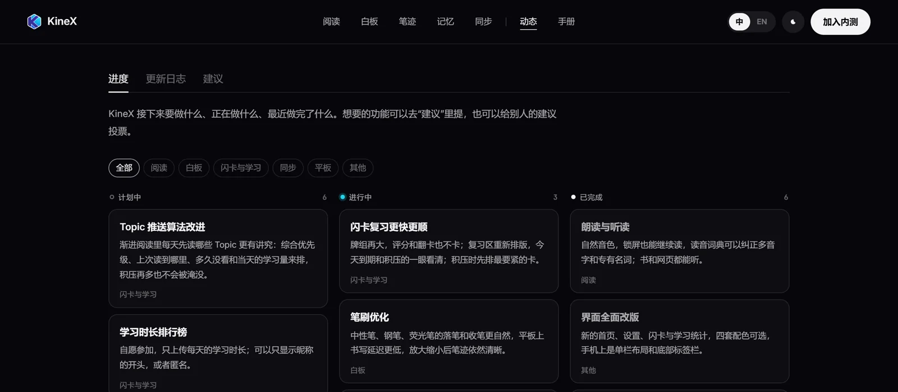

*Settings › Feedback (my feedback and public suggestions); matching suggestions while you type; the website’s roadmap (demo data).*

<a id="updates"></a>

## 17. Updates and notifications

### Checking for updates

KineX checks for a new version shortly after it starts and then once a day, sending only the platform and version number.

To check by hand, open *Settings → General* (设置 → 通用): the *Version* card at the top shows your version and the last check; click *Check for updates* (检查更新).

When there is a new version:

- a note in the bottom-right corner says once that it is ready, with what is new, *Update* and ×; it shows once per version;
- “New version” appears next to the version number at the bottom left of Settings;
- the version card shows “New x.x.x · date · title”; *What's new* (更新内容) lists the new features, improvements and fixes of every version in between.

### Installing a new version

| Platform | Steps |
|---|---|
| Desktop app | Click *Update now* (立即更新) → keep working while it downloads, or cancel → when it is ready, click *Restart and update* (重启并更新). Or leave it and it updates the next time you open KineX. It restarts by itself afterwards; your data is untouched |
| Android app | Click *Download and install* (下载并安装) → *Install* when it is done. The first time, Android asks whether KineX may install apps: allow it, go back to KineX and click *Install* again |
| Browser | Click *Download from the website* (去官网下载) |

The first time you open the updated app, the bottom-right corner shows the new version and its main changes.

Each update's signature is checked after download, and a tampered package is never installed. If the update service cannot be reached, the version card says it will try again later; you can also download the installer from the [website's download page](https://kinexnote.com/download/), where the mirror for mainland China is too.

In-app installation on Android has not been tested on real devices yet.

### Notifications

Background tasks, sync problems and official announcements all go into *Notifications* (通知).

- **Computer:** the notification bar sits in the window; drag it, fold it or open it.
- **Phone:** notifications fold into a small bell at the top right, with a dot when something is unread.

Everyday status never interrupts you; only errors and things that need your decision open by themselves.

**Announcements** come from KineX and show a title, the word “Announcement”, text and a link button. The link only ever goes to kinexnote.com. Click × and the announcement no longer shows on this device; it also disappears when it expires or is withdrawn.

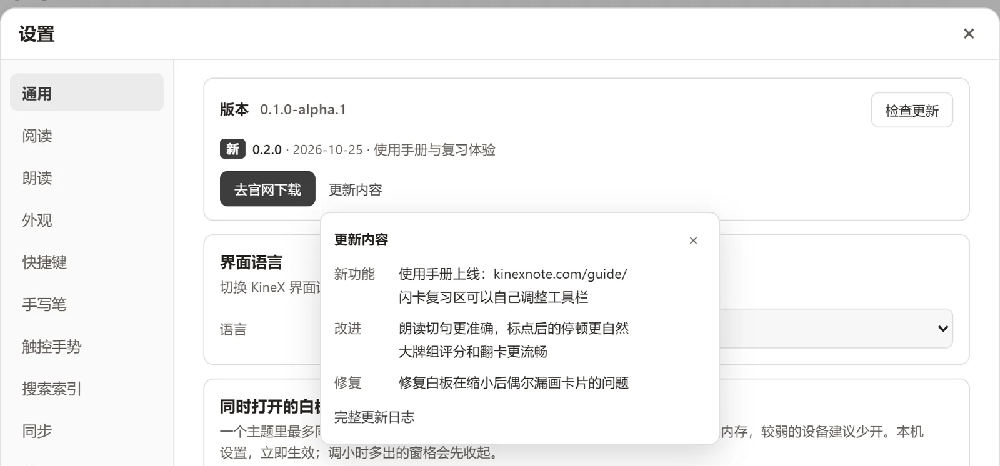

*Settings › General: the version card with a new version, and What’s new.*

<a id="settings"></a>

## 18. Appearance, pen, touch gestures and shortcuts

### Settings at a glance

| Where | What you can change |
|---|---|
| Settings → General (通用) | Version and updates, and general options |
| Settings → Reading (阅读) | Dictionary, keep screen on, TXT chapter rules, web extraction rules |
| Settings → Read aloud (朗读) | Engine, voice, speed, pronunciation dictionary and cache |
| Settings → Appearance (外观) | Light or dark, colour scheme, reading font, theme cover style |
| Settings → Shortcuts (快捷键) | See, change or reset each area's keys |
| Settings → Pen (手写笔) | What the side button and the eraser end do in each area; wet-ink settings on Android |
| Settings → Touch gestures (触控手势) | How the board moves, and what multi-finger gestures do in each area |
| Settings → Search index (搜索索引) | Full-text index progress and maintenance |
| Settings → Sync (同步) | Sync type, connection, key and mode |
| Settings → Data (数据) | Library folder, local data and export, backups before restore |
| Settings → Account / Feedback (账号 / 反馈) | See chapters 15 and 16 (builds with the account service only) |

Most appearance changes apply at once. Double-click a slider to reset it.

KineX has four colour schemes; the default is a neutral grey. Flashcards, board cards and study statistics follow the scheme you pick.

### Touch gestures

*Settings → Touch gestures* sets gestures separately for five areas: board, reader, player, flashcards, and switching / global. Each gesture has a menu: a command of that area, a general command, *Record a key…* (录制按键…) or *Do nothing* (不做事). Delete commands are never offered.

Default gestures:

| Gesture | Default |
|---|---|
| Two-finger tap | Undo (in the player, undo a frame annotation; in flashcards, undo a grade) |
| Three-finger tap | Redo |
| Three-finger swipe left / right | Switch to the other side (reader ⇄ board) |
| Three-finger spread / pinch | The area under your fingers to 100% / back side by side |
| Swipe on empty space in the tablet's top bar | Switch to the other side |
| Other multi-finger taps, swipes, pinches, and long presses | Nothing by default; set them as you like |

- **Repeated multi-finger taps:** either *keep undoing* (each tap undoes one more step, shown as “Undo ×3”) or a gesture of their own.
- When a gesture is recognised, its command name shows briefly under your fingers; you can turn these hints off here.
- Swipes and pinches on the reader and on flashcards act when you lift your fingers, so they do not clash with page turns and zooming.
- *Gesture guide · show again* brings the guide back; each area can be reset to its defaults.

On a computer without a touch screen, the page says no touch screen was found.

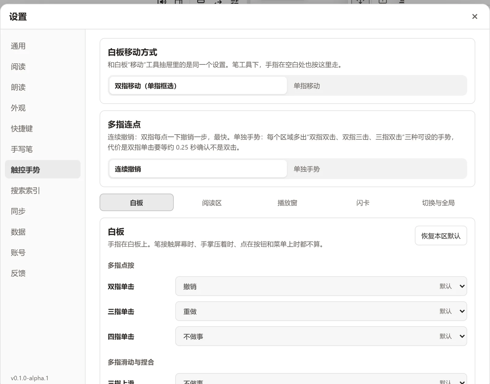

*Settings › Touch gestures: the board’s gestures.*

### Default shortcuts

Shown with Windows' Ctrl. Shortcuts act on the area under the pointer or with focus; while you type text, text editing comes first.

| Area | Keys | Action |
|---|---|---|
| General | Ctrl+F / Ctrl+Shift+F | Find in this area / global search |
| General | Ctrl+, | Open settings |
| Layout | Alt+1 / Alt+2 / Alt+3 | Reader at 100% / side by side / board at 100% |
| Layout | Alt+Q; Alt+\; Alt+Shift+\ | Switch side; left-right / top-bottom; swap sides |
| Layout | Alt+M / Alt+O / Alt+W | Materials panel / contents / board list |
| Reader | T / A / B / H / E / R / M | Text / auto-excerpt / pen / highlighter / eraser / box / selection |
| Reader | Ctrl+= / Ctrl+- / Ctrl+0 | Zoom in / out (font size for text materials) / fit page width |
| Reader | Ctrl+G | Go to page (PDF) |
| Board | V / T / B | Move / text box / pen |
| Board | H / E / M | Marker / eraser / selection |
| Board | Hold Space and drag | Move the canvas for a moment |
| Board | Ctrl+Z / Ctrl+Y | Undo / redo |
| Board | Ctrl+G | Group the selection |
| Board | Shift+1 / Shift+2 | Whole board / zoom to selection |
| Board | Alt+↑; Enter | Parent board; enter a sub-board or edit the selected card |
| Board | Alt+drag / Ctrl+Alt+drag | Box selection / freehand lasso |
| Cards from text | Alt+X / Alt+Z | Make a Topic / an Item |
| Flashcard review | Space; 1 / 2 / 3 / 4 | Show answer; the four grades |
| Player | Space; ← / → | Play or pause; jump back / forward |
| Player | I / O / L | Set point A / point B / loop |
| Video player | S / P; F | Frame grab / frame annotation; full screen |
| Read aloud | Ctrl+Alt+Space | Play or pause |
| Read aloud | Ctrl+Alt+← / → | Previous / next sentence |
| Read aloud | Ctrl+Alt+E | Excerpt the sentence |
| Desktop read-aloud | Ctrl+Alt+F | Show or hide the mini window |

Some read-aloud keys work system-wide in the desktop app and may clash with other programs; change them, or limit them to the page, in Settings. If you have customised shortcuts, the settings page is the reference. If you had already given a new default key to another command, the new command shows as unset, so one key never does two things.

<a id="faq"></a>

## 19. FAQ

### Screens and input

**I can't find the materials, sync or recording button.**  
Look under “⋯” in the top bar first. In a theme on a phone, open the top bar; reading entries may also be in the reading bar (tap the middle of the page).

**My mouse or finger doesn't draw.**  
Pick the pen first, then check the “mouse / touch ink” switch. A stylus uses different input settings from a mouse or finger.

**On a tablet, one finger only draws a selection box on the board.**  
Touch screens default to two-finger move. Pan with two fingers, or switch to one-finger move in *Settings → Touch gestures*.

### Reading, flashcards and media

**There's no card option after I select text.**  
Switch back to the text tool. The highlighter, pen and similar tools don't offer cards for a selection.

**I can't select text in a PDF, or have it read aloud.**  
It is probably a scanned page without a text layer. Excerpt it as a snapshot; search and read-aloud don't run text recognition.

**A card I just made isn't in today's review.**  
New cards get a first date and may not show up the same day. Find it in flashcard management, or open the Topic with *Start reading now*.

**A video won't play on another device.**  
Check whether it links to the original file. A link only syncs the record: link the file on this device, or play it from the original device while it is online on the same network. For online media, also check the server and your sign-in.

**I can't find a read-aloud voice or interface.**  
Check that the engine has voices installed and its forwarding service is on; across devices, that both are on the same network and the phone's address is right. Voices and interfaces are chosen on each device.

**After the original changed, my annotations are in the wrong place.**  
Check whether the material was replaced with another version. Text materials can try relocating by the original text; PDF annotations are kept by position on the page, so check them by hand after pages move or the layout changes.

**Search finds nothing.**  
Check the scope, filters and index progress. Text that has not been indexed yet, scanned pages, and media without text never become searchable on their own.

### Sync and backup

**Can I just copy the library's Markdown as a backup?**  
The readable copies are for looking at; they cannot bring back boards, schedules and attachments. To restore a theme, keep a full `.kinex` package; to restore the library, use a full backup or data history.

**Sync shows a problem.**  
Read the message in the sync window, then check the connection, storage permissions and key; for a conflict, open *Needs your decision*. Don't overwrite this device or the cloud just to make the message go away.

**It says it can't reach KineX Sync.**  
Your changes stay on this device and catch up once connected. Check that the NAS is on, the container is running, and the address and port are right; on a tablet, make sure the address starts with `https://`.

**My tablet can't reach my KineX Sync server, my computer can.**  
The Android app only allows encrypted connections. Set up https for the server (see [chapter 13](#self-hosted-sync)) and use the `https://` address on the tablet.

**A new device can't open the cloud data after I pasted the key.**  
Make sure you pasted the whole line the first device generated, and that the new device uses the same sync target (the same server or storage path). The sync key is not your storage password or your sync account's password.

### Account and updates

**I don't get the code.**  
Check your spam folder and the spelling of your e-mail. To request it again, wait for the countdown on the button; after “too many attempts”, wait an hour.

**It says to update KineX before getting a code, or to update to the latest version.**  
Your version is too old: update in *Settings → General → Version*, or install the new version from the download page.

**It says to connect to the network to continue.**  
This device hasn't been online for its check for too long. Connect it and it recovers by itself; nothing is lost. Or let a device on the same account that is often online sync once.

**It says the account has too many devices.**  
An account has up to five devices. Sign out one you no longer use from the list, then sign in on this device. You can only sign out other devices a limited number of times a year; the page shows how many are left.

**An update never finishes downloading, or fails to install.**  
Cancel it on the version card and try again; if that fails, download the installer from the website's download page, which also has the mirror for mainland China.

**Can I get a dismissed announcement back?**  
No. Once you click ×, it no longer shows on this device; see *Updates* on the website if you need it.
