# KineX 使用手册

把阅读材料、摘录、手写笔记和复习放在一起。

KineX 可以一边阅读，一边把重点放到白板上整理，再把需要记住的内容做成闪卡。阅读、整理和复习之间保留来源，方便随时回到原文。

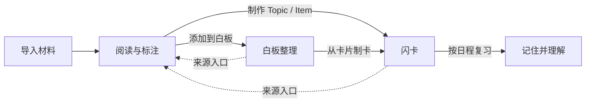

本手册依据 2026 年 10 月 25 日的版本整理。KineX 仍在测试阶段，按钮位置和名称可能变化。

<!-- md-only -->
文中的流程图使用 Mermaid 写法，在 Typora、Obsidian、GitHub、VS Code 等阅读器中会显示为图；不支持的阅读器会显示为文字，内容同样可以读懂。网页版：kinexnote.com/guide/。

## 目录

1. [先完成一次阅读与摘录](#quick-start)
2. [认识首页和工作区](#workspace)
3. [管理主题与素材](#materials)
4. [阅读、标注与摘录](#reading)
5. [在白板上整理知识](#whiteboard)
6. [闪卡、渐进阅读与渐进写作](#flashcards)
7. [学习音视频](#media)
8. [朗读与听读](#read-aloud)
9. [录音与笔记关联](#recording)
10. [搜索与收藏](#search)
11. [学习统计与积分](#learning)
12. [资料库与多设备同步](#sync)
13. [自建 KineX 同步服务](#self-hosted-sync)
14. [导出、备份与恢复](#backup)
15. [KineX 账号与激活码](#account)
16. [反馈与开发进度](#feedback)
17. [版本更新与通知](#updates)
18. [外观、手写笔、触控手势与快捷键](#settings)
19. [常见问题](#faq)
<!-- /md-only -->

### 我想……

| 我想 | 看这里 |
|---|---|
| 第一次上手，十分钟走通一遍 | [第 1 节](#quick-start) |
| 把书里的重点放到白板上 | [第 4 节 · 把重点放到白板](#reading) |
| 把要记住的内容做成卡片并复习；了解哪些学习方法真正有效 | [第 6 节](#flashcards) |
| 听书，或让电脑用手机上的声音朗读 | [第 8 节](#read-aloud) |
| 电脑、平板、手机之间同步 | [第 12 节](#sync)；有 NAS 的话看[第 13 节](#self-hosted-sync) |
| 备份一个主题，或找回之前的内容 | [第 14 节](#backup) |
| 登录账号、兑换激活码 | [第 15 节](#account) |
| 报告问题、提建议、看开发计划 | [第 16 节](#feedback) |
| 更新到新版本 | [第 17 节](#updates) |
| 改快捷键或平板手势 | [第 18 节](#settings) |

<a id="quick-start"></a>

## 1. 先完成一次阅读与摘录

第一次使用，可以先拿一份 PDF 或电子书试一遍。

1. **新建主题。** 在首页点“新建”，取一个容易辨认的名字，例如“摄影入门”。
2. **导入材料。** 打开主题，在素材面板点“＋”→“导入材料”，选择文件。电脑上也可以把文件拖进素材面板。
3. **开始阅读。** 打开导入的材料，阅读区显示正文，白板用来放笔记。
4. **摘录一处重点。** 用高亮工具标出一段文字，点这处标记，在菜单中选“添加到白板”。
5. **写下自己的理解。** 在白板新建文本卡片，补充总结、问题或例子。
6. **回到原文。** 使用摘录卡的来源入口，检查能否回到刚才的位置。

做完后，你就有了一份带来源的学习笔记。之后再按需要使用闪卡、朗读和同步。

<video controls preload="none" playsinline poster="assets/v01-first-excerpt.jpg" src="assets/v01-first-excerpt.mp4"></video>

*新建主题 → 导入 PDF → 高亮一句 → 添加到白板 → 点摘录卡的来源回到原文。*

<a id="workspace"></a>

## 2. 认识首页和工作区

### 几个常用名称

| 名称 | 用来做什么 |
|---|---|
| 资料库 | 保存一整套主题、素材、白板、闪卡和学习记录 |
| 阅读主题 | 围绕一本书、一门课程或一个问题组织资料 |
| 素材 | 主题中的书籍、文档、网页、音频和视频等材料 |
| 阅读区 | 查看原文、播放媒体、标注和摘录 |
| 白板 | 摆放卡片、图片、手写笔记和连线 |
| 闪卡 | 安排再次阅读，或通过问答、挖空等方式复习 |

它们的关系如下：

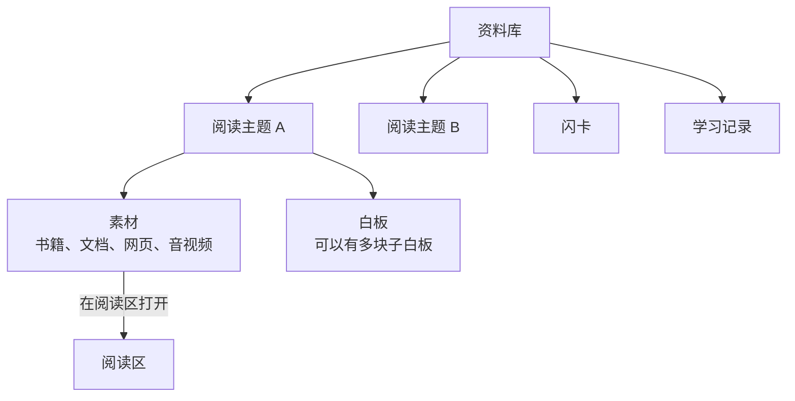

### 首页

“概览”用于继续上次阅读、查看今日学习和浏览书架；“仓库”用于集中管理主题。你可以把主题放进文件夹、收藏，或标为“想读 / 在读 / 读完”。

电脑上单击主题可以选中，双击打开；触屏单击打开。更多操作在右键菜单或长按菜单里。

顶栏没有显示的搜索、统计、同步等入口，可以在“⋯”中找到。桌面端还可以把常用入口固定到顶栏。

**手机首页**使用底部标签栏：概览 · 仓库 · 收藏 · 最近 · 更多。“更多”会从左侧拉出完整导航，包括标签、未分类、丢失材料、归档和文件夹。

### 主题工作区

工作区通常由阅读区和白板组成，可以切换左右或上下布局，拖动分隔线调整大小。需要专注阅读时，可以放大阅读区；需要整理时，可以放大白板。

电脑上可以一步切换布局：

| 想要的布局 | 默认按键 | 其他方法 |
|---|---|---|
| 100% 阅读区（再按一次回到并排） | Alt+1 | 把分隔线拖过边缘，看到“松开：100% 阅读区”后松手 |
| 阅读区与白板并排 | Alt+2 | 双击分隔线，恢复各占一半 |
| 100% 白板（再按一次回到并排） | Alt+3 | 把分隔线拖过另一侧边缘 |
| 切到另一区 | Alt+Q | — |
| 左右 / 上下排列；交换位置 | Alt+\；Alt+Shift+\ | — |

在 100% 白板时点摘录的来源，KineX 会直接切到 100% 阅读区并定位；底部出现“返回白板”，点一下就能回去。反过来，从搜索、收藏或闪卡跳到白板卡片时，会出现“返回阅读”。在 100% 阅读区摘录时，底部提示“已摘到白板 · 看一下”。

### 手机上的工作区

手机打开主题默认显示 100% 阅读区，白板是另一个 100% 页面。

- **切换阅读与白板：** 在顶部窄条上左右滑动。
- **更多主题操作：** 点开或向下拉顶部窄条。面板中的“布局”可选 阅读 / 上下 / 白板；下面一排是首页、录音、收藏和更多。
- **阅读条：** 点页面中间，下方出现 目录 · 素材 · 进度 · 排版 · 朗读 · 白板。拖动“进度”可以跳转；点一项、再点页面或 3 秒不碰，阅读条自动收起。
- **回到首页：** 从屏幕左边缘向右滑。


*首页：继续阅读、今日学习和书架。主题封面由它的材料封面叠成。*


*主题工作区：左边是素材面板和阅读区，右边是白板。*


*手机：首页底部的标签栏（左），点页面中间出现的阅读条（右）。*

<video class="phone" controls preload="none" playsinline poster="assets/v05-phone.jpg" src="assets/v05-phone.mp4"></video>

*手机上打开主题 → 在顶部窄条上横滑切到白板 → 滑回阅读 → 点页面中间打开阅读条。*

<a id="materials"></a>

## 3. 管理主题与素材

### 整理主题

在主题上右键或长按，可以重命名、收藏、归档、设置封面、查看详细信息等。

- **文件夹：** 把相关主题放在一起。
- **收藏：** 把常用主题放到容易找到的位置。
- **归档：** 把暂时不用的主题移出日常列表，之后仍可在归档中找到。
- **阅读状态：** 标记想读、在读、读完，方便筛选。

归档不会删除主题。删除前请读清确认框，确认影响范围。

### 添加材料

在主题素材面板点“＋”，按来源选择：

| 入口 | 适合的内容 |
|---|---|
| 导入材料 | PDF、EPUB、MOBI、AZW3、FB2、TXT、HTML、Markdown，以及本地音视频 |
| 添加网页 | 提取公开文章正文，保存为可阅读的材料 |
| 导入 Markdown 文件夹 | 带有文件夹结构及附件的 Markdown 内容 |
| 添加音视频来源 | 本机原文件、媒体地址或 OpenList 中的音视频 |

网页提取不保证支持需要登录或依赖动态加载的页面。这类内容可以先保存为网页文件或 Markdown 附件包，再导入。

音视频是否能播放，取决于设备支持的编码；受 DRM 保护的电子书不保证可读。

### 音视频：引用还是导入？

添加本地音视频时，会询问保存方式。

| 方式 | 原文件怎么保存 | 适合的情况 |
|---|---|---|
| 引用原文件 | 只登记来源，不把原件复制进资料库 | 文件很大，主要在原设备上使用 |
| 导入数据库 | 原件纳入资料库，随相应备份与同步保存 | 希望在其他设备直接使用 |

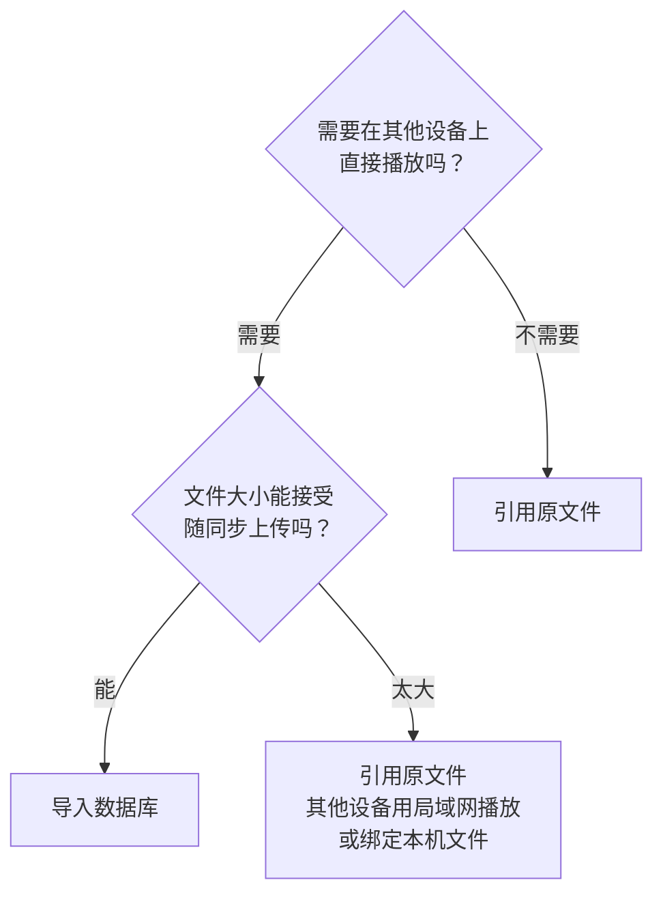

引用不会把音视频原件上传到云端。换设备后，需要绑定那台设备上的文件，或在来源设备在线、局域网条件满足时从它播放。

### 文件夹与标签

素材文件夹适合按章节、课程或来源分类；标签适合跨文件夹归类，例如“待精读”“重要概念”。一份素材可以有多个标签。

KineX 使用全库的标签树。通过素材菜单添加或编辑标签，也可以在标签管理中整理层级。首页的标签入口用于按标签查找相关内容。


*素材面板的“＋”菜单。*

<a id="reading"></a>

## 4. 阅读、标注与摘录

### 找到要读的位置

从素材面板打开材料，使用目录跳转章节。PDF 右下角显示页码，点页码可以输入目标页；双击空白处可适配页宽。

再次打开材料时会恢复已保存的阅读位置。需要同时对照多份材料时，可以使用阅读分屏；多窗格时，先点一下要操作的窗格。

### 调整阅读外观

阅读区设置可以调整纸色、边距和排版。电子书、TXT、Markdown 等文字材料还可以调整字号、字距、行距和段距。

字号等排版调整只作用于当前这份材料，保存在本设备。想恢复书籍原来的排版，可以使用“跟随书籍”或对应的恢复按钮。

阅读字体在“设置 → 外观 → 阅读字体”中选择。PDF 的扫描页仍是图片，更换字体不会让它变成可选文字。

### 高亮、手写与截图

| 想做什么 | 怎么操作 | 阅读区按键 |
|---|---|---|
| 选择文字 | 切到文本选择工具，拖选文字 | T |
| 连续摘录 | 打开自动摘录 | A |
| 标出重点 | 使用高亮工具，选择要保留的句子 | H |
| 在 PDF 上写字 | 使用手写笔工具，在页面上书写 | B |
| 摘录图表或扫描页 | 使用框选截图，保留画面内容 | R |
| 擦掉笔迹 / 选择标记 | 橡皮 / 选区 | E / M |
| 修改已有标记 | 点选标记，再使用它的菜单 | — |

再按一次当前工具的键，会回到上一个工具。这些按键在鼠标位于阅读区时生效。

PDF 可以手写；EPUB、TXT、Markdown 等文字材料主要使用选文和高亮。阅读批注保存在 KineX 中，不会直接改写导入的原文件。

### 把重点放到白板

1. 点选已经做好的高亮或截图标记。
2. 选择“添加到白板”。
3. 在白板上整理生成的摘录卡，添加自己的说明。
4. 需要上下文时，使用卡片的来源入口回到原文。

阅读工具栏的“自动摘录”可以把符合条件的阅读选区直接送到白板，适合连续摘录。只想选择文字、查词或制卡时，先关闭自动摘录。

摘录卡保留来源。材料被删除、换了内容或尚未同步到本机时，可能暂时无法定位，需要先恢复或核对来源。

### 在“笔记”中集中处理

先读完再整理的话，可以打开素材管理面板的“笔记”页。这里列出当前材料的高亮和评论。

- **未摘录：** 默认只显示还没放到白板的内容。
- **全部：** 已在白板的也一起列出，并标“已在白板”。
- 点文字回到原文位置；点“摘到白板”放进白板；点“删除”移除这条标记，删除前会确认，也可以在阅读区撤销。

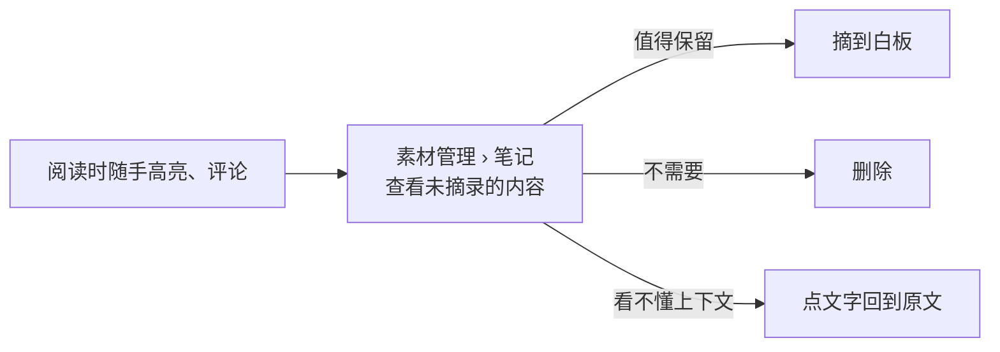


*点一处高亮出现的菜单：样式、颜色，以及添加到白板、制作 Topic、评论和删除。*


*素材管理 ›“笔记”：还没摘到白板的高亮。*

<a id="whiteboard"></a>

## 5. 在白板上整理知识

### 常用工具

| 工具 | 用法 | 按键 |
|---|---|---|
| 移动 | 移动画布，浏览不同位置 | V |
| 文本框 | 新建文字卡片，写总结、问题和例子 | T |
| 手写笔 | 用笔书写或绘图 | B |
| 马克笔 | 用半透明笔迹强调内容 | H |
| 橡皮 | 擦除整笔，或按范围擦掉部分笔迹 | E |
| 选区 | 选择卡片、图片或笔迹，统一整理 | M |

双击文本卡片进入编辑。卡片支持常用文字样式、列表、代码和公式；在行首输入 `/` 可以打开插入菜单。公式编辑时输入公式写法，结束编辑后显示排版结果。

### 移动、缩放与选择

- 按住空格拖动，可以临时移动画布；电脑也可以用鼠标中键拖动。
- 竖向滚轮缩放白板，横向滚动用于平移；触屏可用双指平移和缩放。
- 用选区工具框选多个对象，按住 Shift 可以追加选择。
- 选中内容后，可以移动、复制、编组、对齐或自动排版；删除前确认选区。
- Shift+1 在全部预览和设定比例之间切换；Shift+2 缩放到选区；Alt+↑ 返回上一级白板。

触屏默认“双指移动”：双指平移画布，单指在空白处框选。习惯单指拖动画布的话，可以在白板“移动”工具的选项或“设置 → 触控手势”中改成“单指移动”。

撤销作用于当前白板。打开多块白板时，先点一下要修改的那一块。

### 手写笔、鼠标和手指

手写笔可以直接使用压感。鼠标或手指出墨需要先打开相应开关；如果鼠标只能移动画布，先检查这一项。

在笔设置中选择笔型、颜色和粗细。水彩与蜡笔需要画在画纸上；画纸也方便把一块内容作为整体整理。

**卡片与画纸的缩放不同：** 卡片上的附着笔迹会随卡片变化；画纸、编组主要调整外框，里面的文字和笔迹不会因此一起缩放。

### 结构与链接

卡片上的结构“＋”可以添加子节点，适合整理提纲和层级。用手写笔从一张卡片画向另一张卡片，可以建立知识链接。

链接两端的入口用于跳转。摘录卡的来源入口则用于回到阅读材料，二者用途不同。

### 多块白板

一个主题可以有多块白板。空白处右键或长按，选择“新建子白板”；父白板上会留下入口卡片，双击即可进入，也可以选中后按 Enter。

在白板列表中可以切换、重命名，或选择“在旁边打开”。并排后，可以把内容拖到另一块白板；拖动时按住 Alt 可改为复制。

“引用其他主题的白板”打开的是原白板，编辑会写回原主题。需要独立修改一份内容时，应使用复制。

桌面端还可以把白板分离为独立窗口，适合双屏阅读和整理。


*框选卡片后出现的选区工具条。*

<video controls preload="none" playsinline poster="assets/v02-board.jpg" src="assets/v02-board.mp4"></video>

*新建一张卡片 → 三张卡片排成一列 → 新建子白板 → 在旁边打开。*

<a id="flashcards"></a>

## 6. 闪卡、渐进阅读与渐进写作

### 为什么这样学

KineX 的闪卡建立在三种有研究支持的方法上：**间隔重复**、**测试效应**和**渐进阅读 / 渐进写作**。了解它们，能帮你判断什么时候该制卡、什么时候该继续读。

#### 间隔重复：在快要忘的时候再复习一次

学过的内容会随时间遗忘（即“遗忘曲线”）。同样的复习次数，**分散在几天、几周里**做，比集中在一天里反复看记得牢得多，这叫间隔效应。每复习成功一次，记忆变得更稳，下一次就可以隔得更久。


*实线：按时复习。记忆每次降到 90% 左右时复习一次，评分后回到 100%，之后下降得越来越慢；四次复习在第 3、8、19、50 天，评分依次是困难、一般、一般、容易，下次复习在第 165 天。虚线：学过以后不再复习。实际间隔由每次评分和你设定的“记忆保留率”决定。*

KineX 的复习日程使用开源的 **FSRS** 算法：根据你每次的评分估计这张卡还能记住多久，把它安排在估计快要遗忘的那天。所以评分要如实：想不起来就评“遗忘”，不要为了少复习而评高。

#### 测试效应：主动回想比再看一遍更有用

**主动从记忆里把答案想出来**，本身就是在加强记忆，效果比把答案再读一遍好，这叫测试效应（也叫提取练习）。即使没想起来，看答案前的这次尝试也有帮助。

在 KineX 中，Item 正是为此设计：先看题面、自己回忆，再点“显示答案”。问答、挖空、遮挡图都是测试的形式。

#### 渐进阅读与渐进写作：来自 SuperMemo 的做法

渐进阅读（Incremental Reading）由间隔重复软件 SuperMemo 提出：与其一口气读完再回头整理，不如把很多材料同时放进队列，**每次只读一小段**，把重要的部分摘出来，再一步步提炼成 Item，不重要的就放慢或放下。渐进写作沿用同样的思路，把一篇文章分成多次、每次写一点。

这正是 KineX 中 Topic 和 Item 的分工：Topic 安排“接下来读什么、写什么”，Item 负责“记住了没有”。具体做法见下文的[渐进阅读](#incremental-reading)和[渐进写作](#incremental-writing)。

### 学习方法效果评分

2013 年，Dunlosky 等五位认知与教育心理学家回顾了大量研究，对十种常见学习方法的**实用性**打了分：高、中、低。评分考虑的是方法是否对不同学习者、不同材料、不同考查方式都普遍有效，以及证据是否充足。

| 效果 | 学习方法 | 做法 | 在 KineX 中怎么用 |
|---|---|---|---|
| **高** | 分散练习 / 间隔效应（Distributed practice） | 把学习和复习分散到不同时间 | 闪卡按 FSRS 日程复习；Topic 按日程分多次读 |
| **高** | 练习测试 / 测试效应（Practice testing） | 做题、自测、用闪卡回想 | 制作 Item，复习时先回想再看答案 |
| 中 | 交替练习 / 交错练习 / 跨学科练习（Interleaved practice） | 把不同类型的题目、不同主题穿插着练 | 一次复习多个主题的卡，不必按主题分开刷 |
| 中 | 自我解释（Self-explanation） | 学的时候向自己解释每一步、每个结论的道理 | 在白板上用自己的话写下“这一步为什么成立” |
| 中 | 深入提问（Elaborative interrogation） | 追问“为什么是这样”“为什么会这样” | 把“为什么”写成 Item 的题面，或在白板上建问题卡 |
| 低 | 概括（Summarization） | 把内容写成摘要 | 白板上的总结适合整理思路；要记住的部分再做成 Item |
| 低 | 高亮（Highlighting） | 在原文上划线、标出重点 | 高亮只是第一步：之后用“添加到白板”或制卡继续加工 |
| 低 | 关键词助记符（The keyword mnemonic） | 用发音相近的词和联想记生词 | 只适合少量词汇；可用遮挡图 Item 练习 |
| 低 | 图像辅助学习（Imagery use for text learning） | 读文字时在脑中构想画面 | 可以在白板上画草图，但不要代替回想练习 |
| 低 | 重读（Rereading） | 把材料再读一遍 | 用 Topic 的渐进阅读代替被动重读：每次读一段并摘录 |

“低”不等于没用：这些方法在特定情况下仍有帮助，只是证据显示它们效果有限，或者只在部分情况下有效。最常用的高亮和重读得分偏低，而间隔复习和自测得分最高，这也是 KineX 鼓励“高亮之后继续制卡、按日程复习”的原因。

#### 适用范围细分

论文还从五个方面逐项评估了每种方法（原文 Table 4）：

| 学习方法 | 效果 | 不同学习者 | 不同材料 | 不同考查方式 | 实施难度 | 真实教学场景 |
|---|---|---|---|---|---|---|
| 练习测试 | **高** | ✓? | ✓ | ✓ | ✓ | ✓ |
| 分散练习 | **高** | ✓? | ✓ | ✓? | ✓ | ✓? |
| 交替练习 | 中 | ? | △ | ✓? | ✓ | ✓? |
| 自我解释 | 中 | ✓? | ✓ | ✓? | △ | ? |
| 深入提问 | 中 | ✓? | ✓ | ? | ✓ | ? |
| 概括 | 低 | △ | ✓? | △ | △ | ? |
| 高亮 | 低 | △ | △ | ✗ | ✓ | ✗ |
| 关键词助记符 | 低 | △ | △ | △? | △ | △? |
| 图像辅助学习 | 低 | △ | △ | △? | ✓ | ? |
| 重读 | 低 | ? | ✓ | △? | ✓ | ? |

图例：

- **✓ 有效**：现有证据表明，这种方法在这一方面有效（原文 P）。
- **△ 有条件**：只在部分条件或部分人群中有效（原文 Q）。
- **✗ 基本无效**：在这一方面基本没有效果（原文 N）。
- **? 证据不足**：证据不够，无法下定论（原文 I）。两个符号连写，如“✓?”，表示整体有效、但其中部分因素证据不足（原文 P-I、Q-I）。
- “实施难度”一栏中，✓ 表示容易上手、不需要专门训练；“真实教学场景”指在课堂等实际环境中是否得到验证。

从表中可以看到，只有练习测试和分散练习在几乎所有方面都是“有效”；高亮在“不同考查方式”和“真实教学场景”两栏都是“基本无效”，尽管它最容易上手。

> 资料来源：Dunlosky, J., Rawson, K. A., Marsh, E. J., Nathan, M. J., & Willingham, D. T. (2013). Improving Students’ Learning With Effective Learning Techniques: Promising Directions From Cognitive and Educational Psychology. *Psychological Science in the Public Interest*, 14(1), 4–58. [doi:10.1177/1529100612453266](https://doi.org/10.1177/1529100612453266)

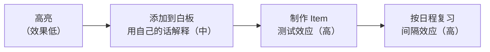

### 先分清两类卡

| 类型 | 用来做什么 | 示例 |
|---|---|---|
| Topic | 留下一份材料或一个片段，之后继续阅读、理解和拆分 | 一节课程、一段论述 |
| Item | 检查自己是否记住了具体知识 | 一个问题、一处挖空、一张遮挡图 |

Topic 解决“下一次读什么”，Item 解决“这件事记住了吗”。

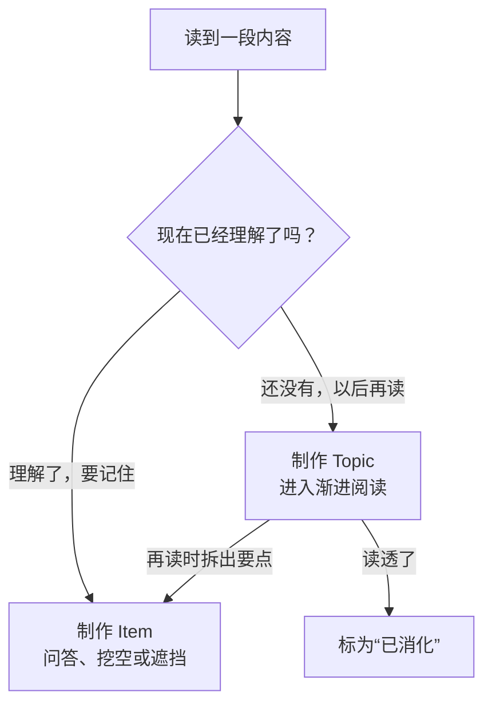

### 从阅读内容制卡

1. 在阅读区切到**文本选择**工具，选中内容。
2. 在选区旁选择“制作 Topic”或“制作 Item”；也可以用 Alt+X、Alt+Z。
3. 检查内容和来源。制作 Item 时，设置要回忆的答案或遮挡范围。
4. 保存后，在闪卡管理中找到它。

高亮、手写等工具下不会触发选文制卡。对已有的高亮或截图，也可以先点它，再从菜单制作 Topic。

如果希望整本书或整份媒体进入渐进阅读，在素材菜单中选择“加入渐进阅读”。加入后会提示首次安排日期，也可以选择“现在开始阅读”。

新卡不一定当天出现在复习队列中。想马上查看，可以从管理列表打开，或使用加入后的阅读入口。

<a id="incremental-reading"></a>

### 渐进阅读：一本书拆成能记住的卡

渐进阅读适合篇幅长、一次读不完、又想真正吸收的材料。

1. **放进队列。** 在素材菜单中选“加入渐进阅读”，整本书或整份媒体成为一个 Topic。可以同时放进多本书。
2. **每次读一段。** Topic 到期后，从上次的位置读一小段即可，不必读完。
3. **摘出重点。** 在 Topic 中选中重要的句子，用工具栏的“摘录”做成更小的 Topic；已经理解、要记住的，用“制卡”直接做成 Item。
4. **评分决定下次。** 读完这一段，选“重读 / 想读 / 一般 / 缓读”，安排多久后再读。
5. **逐步提炼。** 小 Topic 下次再读时继续精简，直到能写成一两个 Item。
6. **处理完就放下。** 一个 Topic 已全部摘录或不再需要时，标为“已消化”（音视频为“学完了”），它不再出现，内容和来源都保留。

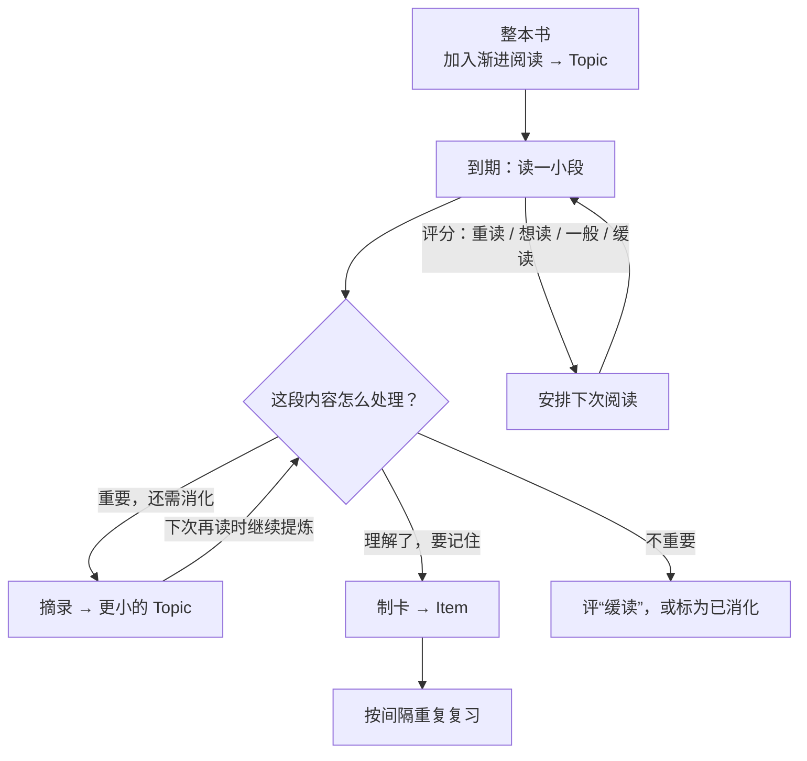

**优先级** 决定同一天先读、先复习哪些卡。在复习区点“优先 50”这样的按钮可以调整，范围 0–100，数值越大越优先；它只影响之后的安排，不改学习历史。积压较多时，重要的书给高优先级，次要的放低。复习设置中还可以让重要的卡用更高的记忆保留率。

<a id="incremental-writing"></a>

### 渐进写作：一篇文章分多次写完

想写读书笔记、综述或文章时，可以把一个文字 Topic 设为写作模式，每次复习时接着写一点。

1. 复习一个文字 Topic 时，点卡片上方的“写作”，它就成为写作 Topic，复习间隔比阅读 Topic 短。
2. 用阶段下拉框标出进度：草稿 → 修改 → 定稿。
3. 相关的零散 Topic 可以用“合并…”并进这篇：它们的正文按标题追加到末尾，被合并的 Topic 标为已消化，从中摘出的 Item 仍保留原来源。
4. 选“定稿”时，可以“标为已消化”（不再安排），或“转为阅读 Topic”（按“缓读”节奏偶尔回顾）。

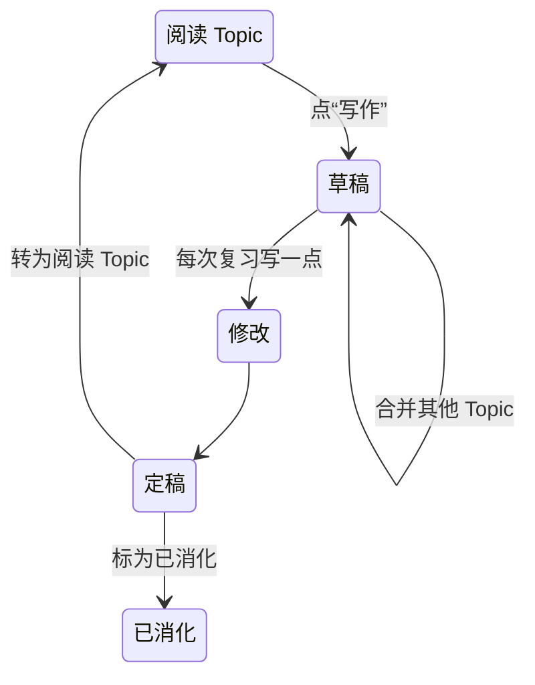

### 日常复习

从顶栏“闪卡”进入。首页也可能显示今天需要复习的数量和入口。

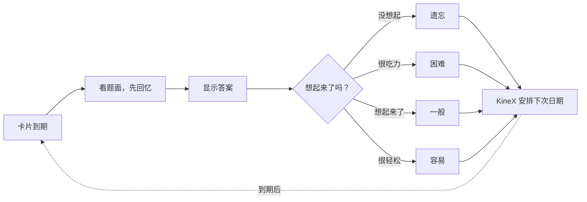

- **Item：** 先回忆，再点“显示答案”。按实际情况选择“遗忘 / 困难 / 一般 / 容易”，按钮下方显示预计多久后再见，例如“10 分钟后”“3 天后”；具体日期在按钮提示里。
- **Topic：** 阅读后选择“重读 / 想读 / 一般 / 缓读”，决定多久以后继续看。
- **暂时不想处理：** 使用本轮跳过或稍后再看。
- **评分点错：** 在复习区域撤销最近一次评分；触屏也可以双指单击撤销。

浏览卡片不会改变复习安排，正式复习中的评分才会调整日程。Topic 已经理解完毕时，可以标为“已消化”，停止继续安排，同时保留内容和来源。

### 调整复习工具栏

复习区的工具都写着图标和两个字，例如编辑、来源、跳过、稍后、撤销、排除。换卡时它们的位置不变；某张卡用不到的工具会变灰。

放不下的工具收在“更多”里。“更多 → 调整工具栏…”可以拖动排序、设置哪些常驻，也可以“恢复默认”；不需要文字时选“只显示图标”。这些偏好只保存在本设备。

### 设置复习量

初次使用可以保留默认设置。积压明显时，先减少每天新增的卡片。

“记忆保留率”表示希望复习时仍能想起内容的比例：调高后复习通常更频繁，工作量也会增加。未来工作量是估计值，会随你的评分变化。

一张卡反复忘记时，优先把它拆小或改写。KineX 的“需改写”提示不会自动替你删除或排除这张卡。


*上：从选文制作挖空 Item；下：复习时显示答案后的四档评分，左侧管理树里有 Item 和 Topic。*

<video controls preload="none" playsinline poster="assets/v03-make-item.jpg" src="assets/v03-make-item.mp4"></video>

*从一段原文制作 Item → 设答案并预览 → 提前复习 → 显示答案 → 评分。*

<a id="media"></a>

## 7. 学习音视频

### 添加本机或在线媒体

从素材“＋”→“添加音视频来源”选择来源。添加后像打开其他材料一样打开它。

使用 OpenList 时：

1. 添加连接，填写名称、服务地址，以及需要的账号和密码。
2. 点“测试并保存”。
3. 浏览目录，勾选文件或文件夹，添加所选内容。

OpenList 媒体保留服务地址与文件路径，播放时仍需要能访问该服务。连接信息和记住的密码会随资料库加密同步，登录状态由各设备分别保存。

多节课程可以按顺序加入渐进阅读。确认前先检查列表顺序，避免按文件名排错课次。

### 播放器的两行按钮

| 行 | 包含什么 |
|---|---|
| 播放行 | 播放 / 暂停、跳转（例如 ±5s）、上一句 / 重播本句 / 下一句（有字幕时）、时间、倍速、音量、画面字幕、音轨、画中画、全屏 |
| 学习行 | 截帧（音频为“加标记”）、摘录、手写；片段、Topic、Item、渐进；标记、章节、筛选 |

播放器变窄时，学习行会排成网格，再窄只显示图标。标题行左侧显示当前章节，例如“3/12 标题”，点开可以选章节。

### 字幕、章节与定位

播放器支持字幕、章节和标记。点字幕或章节可以跳到对应时间；有需要时可以加载外挂字幕。

字幕能力取决于字幕格式。图片字幕不等于可选文字，也不能据此自动得到文字摘录。

### 保留一个重点

| 想保留什么 | 使用什么操作 |
|---|---|
| 当前画面 | 截帧，按设置直接加入白板，或先编辑备注 |
| 当前时间 | 时间戳摘录，留下可返回的时间位置 |
| 对画面的说明 | 画面标注，写完后确认保存 |
| 一段反复播放的内容 | 设置 A、B 两个时间点，开启循环 |
| 需要复习的片段 | 选择区间或字幕，制作 Topic / Item |

制作片段卡时，第一次点制卡按钮设置起点，第二次设置终点，再检查区间。已有 A–B 区间时可以直接使用；也可以选中字幕后制卡。

片段 Item 需要区间内有字幕，或使用支持的画面遮挡方式。保存后的卡片可以播放来源片段，方便复习时核对。

画面标注不会改写视频原文件。A–B 片段保存在本设备，不会自动跟随主题同步。


*播放器：画面字幕、按章节分组的字幕栏、时间条上的 A–B 区间，以及下面的学习按钮。*

<a id="read-aloud"></a>

## 8. 朗读与听读

文字材料的“朗读”把文字读出来；音视频的“听读”播放材料本身的声音。打开音视频后，点播放器的“听读”即可进入；有字幕时可以按句切换和摘录字幕。

### 开始朗读

1. 打开可读的 PDF、EPUB、TXT、Markdown 或网页材料。
2. 点阅读工具栏的“朗读”，从屏幕上的第一句开始；先选中文字，则从那里开始。
3. 用播放条暂停、切换句子、重读本句，或调整语速。
4. 听到重点时，点“摘录本句”或“摘录本段”，把内容留到白板。

当前句可以高亮并跟随阅读。你也可以暂时浏览别处，再点“回到朗读位置”。定时暂停可以按时长或按读完某一部分来设置。

PDF 需要有可提取文字。扫描页没有文字层时，不能直接朗读。

### 选择声音

打开“设置 → 朗读”，选择朗读引擎和声音，再点“试听”。默认使用设备的系统语音。

KineX 不附带第三方语音引擎或声音包。如果希望使用其他声音，需要先准备自己的语音服务，再添加“朗读接口”。

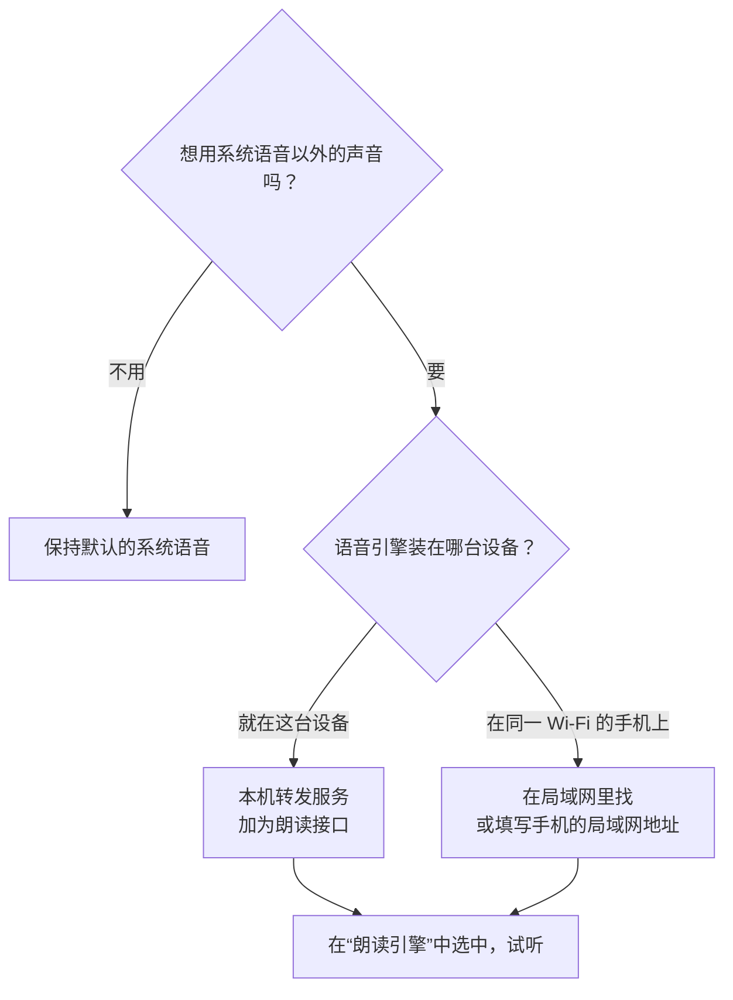

### 添加本机朗读接口

适用于你已经安装了提供“转发服务”的语音引擎。

1. 按引擎自身的说明装好声音，打开转发服务。
2. 在 KineX 的“设置 → 朗读”中，找到“本机转发服务”，点“加为朗读接口”。
3. 没有找到时，点“添加朗读接口…”，填写引擎实际显示的地址，例如 `http://127.0.0.1:8774`。端口以引擎设置为准。
4. 在“朗读引擎”中选中它，试听确认。

### 电脑使用手机上的声音

1. 手机和电脑连接同一个 Wi-Fi，手机的转发服务保持开启。
2. 电脑打开“设置 → 朗读”，点“在局域网里找”。
3. 找不到时，手动填写手机显示的局域网地址，例如 `http://192.168.1.23:8774`。
4. 选中这个接口，试听确认。

电脑上的 `127.0.0.1` 指向电脑自己，不能用它访问手机。使用手机的声音，应填写手机的局域网地址。

朗读接口会收到需要朗读的文字，请使用你信任的地址。手机长期锁屏、仅作为电脑语音服务器的用法仍待验证。

### 读音词典与缓存

- **读音词典：** 在“设置 → 朗读 → 朗读内容”中，为人名、多音字或术语指定读法。它只改变读法，不修改原文；词条会随资料库同步。
- **朗读缓存：** 接口合成的声音保存在本机，重复收听时可以复用。可在朗读设置中管理容量和删除缓存；缓存不备份、不同步，系统语音不使用这份缓存。

### 小窗与锁屏

桌面安装版可以从播放条“弹出小窗”，边做其他事边听。安卓安装版支持后台播放及锁屏控制；是否显示专用锁屏页，可在相关设置中调整。

浏览器中的朗读受浏览器后台策略影响，不能据此保证锁屏后持续播放。

如果 KineX 和转发引擎装在同一台三星设备上，关屏后句子之间出现停顿，可以试着关闭引擎里的“阻止休眠”选项。手机只给电脑提供声音时，这条建议不一定适用。


*上：朗读时当前句加下划线，播放条在底部；下：设置 › 朗读。*

<video controls preload="none" playsinline poster="assets/v04-read-aloud.jpg" src="assets/v04-read-aloud.mp4"></video>

*用平板上的语音引擎朗读 PDF → 下一句 → 摘录本句到白板。*

<a id="recording"></a>

## 9. 录音与笔记关联

主题工作区的顶栏或“⋯”中有录音入口。开始录音时才会申请麦克风权限。

1. 打开录音窗口，选择可用音源。
2. 开始录音，同时在白板或 PDF 上记录重点。
3. 重要时刻可以加书签，也可以选中内容后手动关联当前时间。
4. 结束录音，等待保存完成。

录音期间，支持的笔记操作会自动关联到录音时间。选中带自动关联的笔记，使用“播放关联录音”，可以从写下它前一点开始回听。手动添加的关联可从录音的关联列表进入。

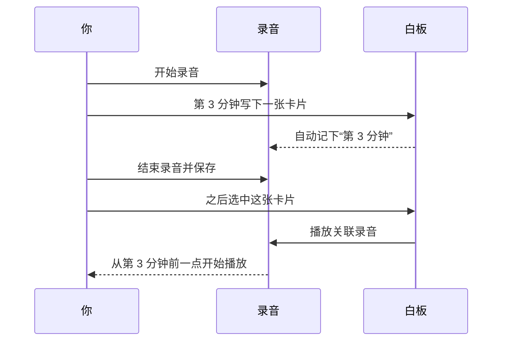

关闭录音浮窗不会停止录音。浏览器页面进入后台时录音会暂停，返回后需要手动继续；长时间录音前先确认当前平台的行为。


*录音中：可以加书签，或把选中的笔记关联到此刻。*

<a id="search"></a>

## 10. 搜索与收藏

### 查找当前内容或整个资料库

| 范围 | 入口 |
|---|---|
| 当前材料或白板 | 先点对应区域，再按 Ctrl+F |
| 整个资料库 | Ctrl+Shift+F，或顶栏“⋯”→ 全局搜索 |

先输入普通关键词，再按需要筛选范围。搜索支持引号短语、多个词同时匹配和排除词等写法。

全文搜索需要已建立相应索引，进度可在“设置 → 搜索索引”中查看。没有结果时，先检查搜索范围和索引进度。搜索不会自动给扫描页做文字识别，也不会自动把音视频转成文字。

### 两种收藏

- **主题收藏：** 在首页收藏整个主题，方便继续阅读。
- **白板内容收藏：** 选中卡片或笔迹，在选区操作栏点星标，保存到全局收藏；之后可以拖到其他白板使用。

全局收藏可以按来源、类型、分类和评分筛选。找不到收藏时，先清除不需要的筛选条件。


*全局搜索“复习”：卡片、批注和材料正文里的结果。*

<a id="learning"></a>

## 11. 学习统计与积分

从首页“今日学习”或顶栏入口打开“学习统计”，查看阅读、整理和复习的记录。三类时间分别用三种颜色标出：阅读跟随当前配色，整理为青绿，复习为琥珀。

日历可以查看某天的时长和学习时段，图表用于观察近期习惯。设置每日时长目标或每周读完目标，可以帮助安排节奏。

学习计时根据活动状态判断，不是只要开着 KineX 就一直累加。对计时有疑问时，查看页面中的计时状态说明。

### 积分、任务与兑换

奖励属于可选的激励功能，不影响阅读和复习。

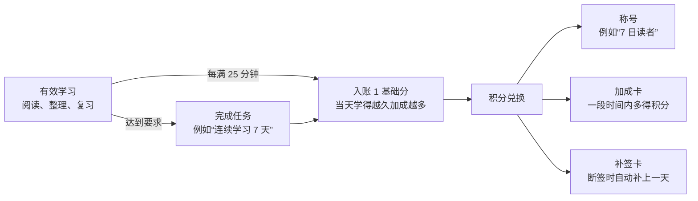

- **任务** 直接写明要求，例如“连续学习 7 天”“累计学习 100 小时”。“学习 1 天”指当天有效学习满 25 分钟。
- **未满 25 分钟** 的进度会跨日保留，攒满后才算进可用积分。
- **积分公式与入账规则** 可在页面中展开查看。

接入同一资料库同步后，学习记录可以汇总到其他设备。


*学习统计：日历、当天时段和各项进度。*

<a id="sync"></a>

## 12. 资料库与多设备同步

### 本机保存与资料库文件夹

日常编辑会自动保存在本机。云端同步需要单独设置。

在支持资料库文件夹的桌面环境中，可以按首次提示选择本地文件夹，也可以稍后到“设置 → 数据”配置。素材按主题整理，便于在资源管理器中找到。

- `Themes/`：按主题保存的素材及笔记文字版。
- `Flashcards/`：闪卡文字版。
- `.kinex/`：KineX 管理资料库所需的内部内容，请不要手动修改。

笔记、闪卡的文字版便于在外部查看，修改文字版不会回写到 KineX。只复制这些可读文件，不能代替完整备份。

请选择本地文件夹，不要放到 OneDrive、Dropbox 等网盘的实时同步目录中。跨设备使用请配置 KineX 自带同步。

桌面端可以新建、打开和切换多个资料库；每个库分别保存资料与同步连接。手机、平板目前按单库使用。

### 选择同步方式

同步设置在“设置 → 同步”。KineX 不提供公共云盘，资料存在你自己的服务器或存储里，上传前用同步密钥加密，服务器看不到内容。

| 类型 | 适合的情况 | 改动多快到另一台 |
|---|---|---|
| KineX 同步服务（实时） | 有 NAS 或自己的服务器，愿意部署一个 Docker | 另一台在线时几乎马上收到 |
| S3（MinIO、R2、OSS 等） | 已有对象存储 | 按自动同步的节奏，通常几十秒以上 |
| WebDAV | 已有 WebDAV 网盘或 NAS 目录 | 同上 |

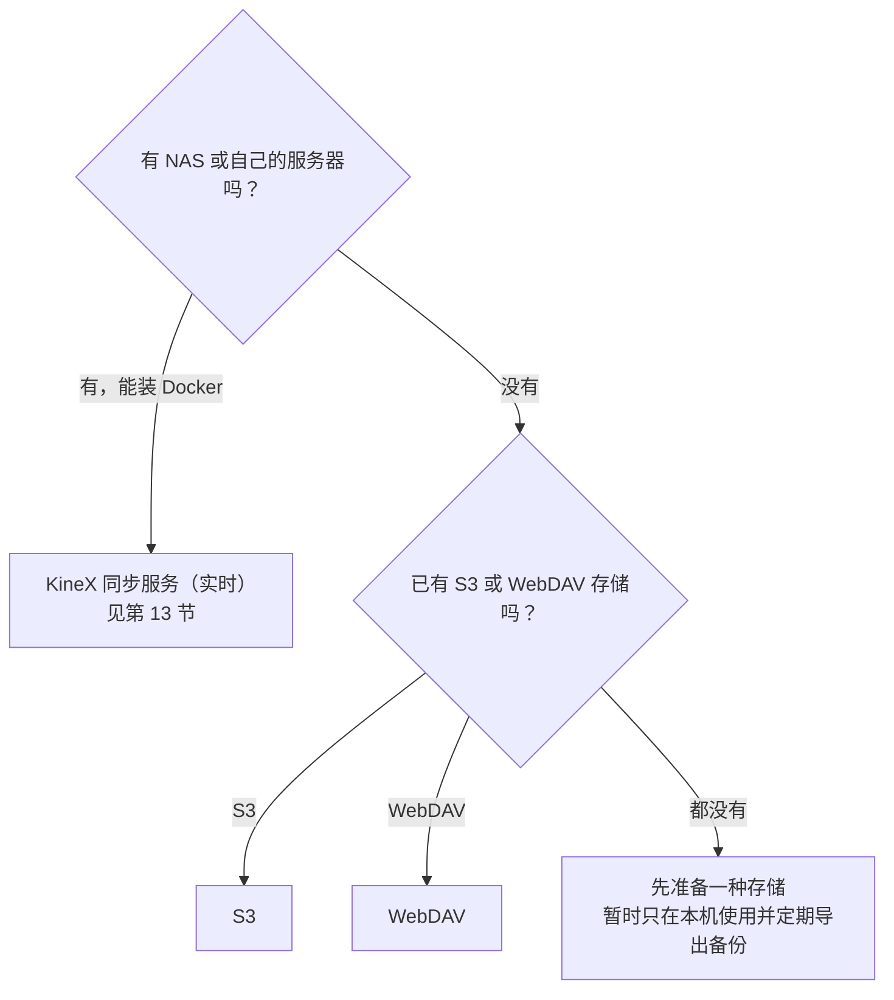

S3 和 WebDAV 只有在局域网或本机地址上才允许使用 `http://`；公网地址请使用 `https://`，以免泄露存储凭据。

### 几种“账号”和“密钥”别弄混

| 名称 | 是什么 | 在哪里填 | 丢了会怎样 |
|---|---|---|---|
| 同步密钥 | 以 `KX2-` 开头的一行字，用来加密和解开云端资料 | 设置 → 同步，每台设备粘贴同一行 | 新设备无法解开现有云端资料；请另存一份 |
| 存储凭据 | S3 的访问密钥，或 WebDAV 的用户名和密码 | 设置 → 同步（S3 / WebDAV） | 到存储服务那里重新获取 |
| 同步服务账号 | 自建 KineX 同步服务中由管理员建的登录名和密码 | 设置 → 同步（KineX 同步服务） | 请管理员在管理面板重设密码 |
| KineX 账号 | 用邮箱验证码登录，用于激活码、联网验证和反馈；不保存笔记 | 设置 → 账号 | 用同一邮箱重新登录即可 |

### 第一台设备：建立云同步

1. 打开“设置 → 同步”，选择类型。
2. 填写连接信息：
   - S3 / WebDAV：填写存储服务提供的地址和凭据，点“保存并测试”；
   - KineX 同步服务：填写服务器地址、账号、密码和“这台设备的名字”，点“登录并测试”。
3. 选择“这是第一台设备：生成密钥”。
4. 把同步密钥另存到 KineX 以外的地方，例如密码管理器，勾选“我已保存这行密钥”，再开始同步。
5. 等待首次上传完成，检查同步状态。

同步密钥用于解开云端资料，与存储服务或同步账号的密码不同。添加设备时需要它，丢失后无法在新设备解开现有云端资料。之后需要再看密钥，可以使用“显示密钥（添加其他设备）”。

### 其他设备：加入已有资料库

1. 使用一个空的资料库；已有自己的资料时，先备份并另行整理。
2. 填写与第一台设备相同的同步目标，测试连接。
3. 选“已有密钥：加入资料库”，粘贴同一行密钥。
4. 点“加入并下载”，按提示等待完成或重新打开 KineX。

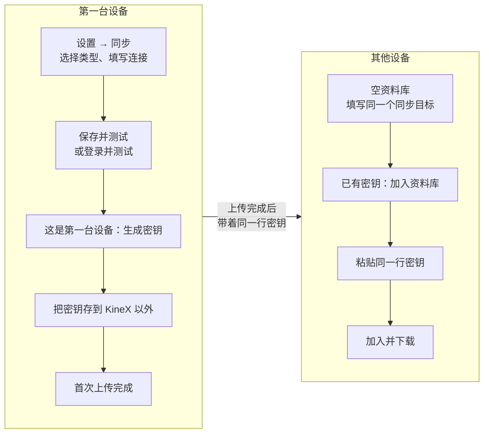

每台设备分别设置云连接与同步密钥。无需在新设备重新生成一套密钥。

### 日常同步

“资料库同步”窗口用于立即同步和查看问题；连接、密钥及高级操作放在设置中。

| 同步方式 | 什么时候同步 | 可用于 |
|---|---|---|
| 实时 | 改动马上送到其他在线设备；离线时先留在本机，连上后自动补齐 | KineX 同步服务 |
| 自动同步 | 有改动后在空闲时同步；离开或关闭时，还有没同步的改动就补一次 | S3 / WebDAV |
| 手动同步（启动和关闭时各同步一次） | 打开时一次，关闭或转到后台时有改动再补一次；中途可手动同步 | S3 / WebDAV |
| 手动 / 完全手动同步 | 只在你点“立即同步”时同步 | 全部类型 |

换设备前，最好确认当前设备已同步完成。不要把强制结束应用当作一次可靠的关闭同步。

使用 S3 或 WebDAV 时，同一资料库的可信设备在局域网内可以加速传输（“局域网同步加速”）；云端仍负责保存和协调资料库。

### 哪些内容会跟过去？

主题、白板、纳入资料库的素材、批注、闪卡、学习记录、阅读位置、标签、读音词典、OpenList 连接，以及部分常用设置会随资料库同步。

窗口位置、分屏布局、文件访问授权、复习工具栏偏好、关掉的公告等设备设置通常留在本机。朗读接口和声音按设备设置，朗读缓存也不会同步；引用的本机音视频原件不会因同步而自动上传。

### 出现冲突时

两台设备的不同内容会尽量合并；同一处出现无法直接取舍的修改时，同步中心会显示“需要你决定”。

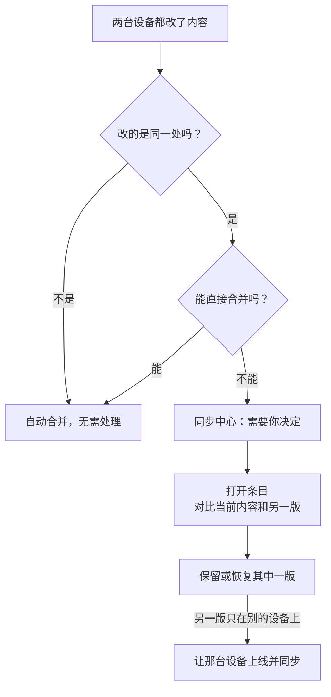

打开对应条目，先看当前内容和另一版，再选择保留或恢复。某些选择需要在保存另一版的设备上执行，应让那台设备上线并同步。

使用 KineX 同步服务时，两台设备都在线的修改会实时排队，一般不再出现冲突；离线期间两边都改了同一处，仍按上面的方式处理。

日常使用“同步”即可。“用云端覆盖本机”和“用本机覆盖云端”会改变采用哪一份内容，只在明确知道用途时使用。


*“资料库同步”窗口：还没连接云端存储时，点“去设置”。*


*设置 › 同步，类型选“KineX 同步服务（实时）”（地址为示例）。*

<a id="self-hosted-sync"></a>

## 13. 自建 KineX 同步服务

KineX 同步服务（kinex-sync）是一个可以自己部署的实时同步服务器，打包为 Docker，适合装在飞牛 OS、群晖或任意 Linux 主机上。

- **实时：** 一台设备改了内容，其他在线设备几乎马上收到，冲突比 S3 / WebDAV 少得多。
- **多账号：** 可以给家人分别建账号，各自的资料库互相独立。
- **只存密文：** 同步密钥只在你的设备上，管理员和服务器都看不到笔记内容。
- **自带管理面板：** 建账号、限制空间、移除设备、定时备份都在网页里完成。

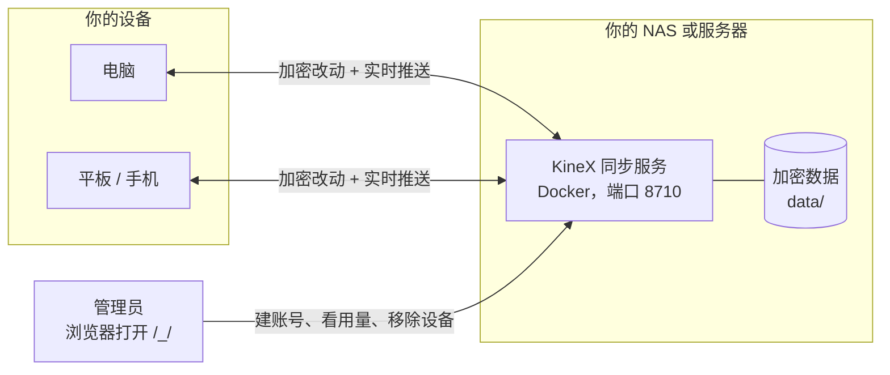

### 部署前准备

| 需要 | 说明 |
|---|---|
| 一台常开的设备 | NAS 或 Linux 主机，已安装 Docker；x86-64 和 ARM64 都可以 |
| 部署文件 | `Dockerfile`、`compose.yml`、对应架构的程序文件和证书文件；正式提供下载的位置待发布时补充 |
| 端口 | 默认 8710，局域网内能访问即可 |
| https（安卓需要） | 安卓正式版只允许加密连接；电脑版可以直接用局域网 `http://` 地址 |

### 部署步骤（以飞牛 OS 为例）

1. 在存储空间中新建文件夹，例如 `docker/kinex-sync`，放入部署文件。ARM 设备使用 ARM64 的程序文件，并按说明修改 `compose.yml` 中的架构。
2. 把 `compose.yml` 中的 `user:` 改成 NAS 上你的用户和组编号（SSH 中运行 `id` 可以看到），这样数据文件属于你，方便在文件管理中备份。
3. 打开飞牛 Docker → Compose → 新增项目，路径选这个文件夹，启动。镜像在本机构建，不从网上拉取。
4. 浏览器打开 `http://<NAS 地址>:8710/_/`，看到管理面板即部署成功。

### 第一次：建管理员

任选一种：

- 打开容器日志（飞牛 Docker → 容器 → kinex-sync → 日志），找到以 `/_/#/pbinstal/` 结尾的链接，把其中的 `0.0.0.0` 换成 NAS 地址后打开，填写管理员邮箱和密码。链接过期时重启容器即可得到新链接。
- 在 SSH 中运行（把邮箱和密码换成你自己的）：

```bash
docker exec kinex-sync /kinex-sync superuser upsert 你的邮箱 你的密码 --dir /data
```

管理员只用来登录管理面板，不是同步账号。

### 给自己和家人建同步账号

管理面板为英文界面，字段旁有中文说明。

| 要做的事 | 在哪里 |
|---|---|
| 新建同步账号 | Collections → users → New record：填 `username`（登录名）和 `password`；`email` 可不填 |
| 修改空间上限 | users → 点开账号 → `quotaGB`（0 表示使用默认值） |
| 停用账号 | users → 勾选 `suspended`：不能登录和同步，数据保留 |
| 查看用量 | users 的 `usedGB`；libraries 的大小、条目数和最近改动 |
| 移除丢失的设备 | Collections → devices → 找到设备 → 勾选 `revoked`：它会马上断开，不能再同步 |
| 删除不要的云端资料库 | Collections → libraries → 删除：只删服务器上的这一份，各设备上的资料不受影响 |
| 定时备份 | Settings → Backups：可以定时备份，也可以备份到 S3 |

### 在 KineX 中连接

1. 打开“设置 → 同步”，类型选“KineX 同步服务（实时）”。
2. 填写服务器地址（例如 `http://192.168.1.2:8710` 或你的 `https://` 域名）、账号、密码，以及“这台设备的名字”。
3. 点“登录并测试”。密码只用于这一次登录，本机只保存登录凭证。
4. 第一台设备选“这是第一台设备：生成密钥”；其他设备选“已有密钥：加入资料库”，粘贴同一行密钥。后续步骤同[第 12 节](#sync)。

连接后，同步设置会显示账号、服务器和已用空间；资料库同步窗口显示“实时同步 · KineX 同步服务 · 在线：…”。同步方式只有“实时”和“手动”两种。

在设置中“退出登录”后，这台设备停止同步；服务器上的资料和其他设备不受影响。

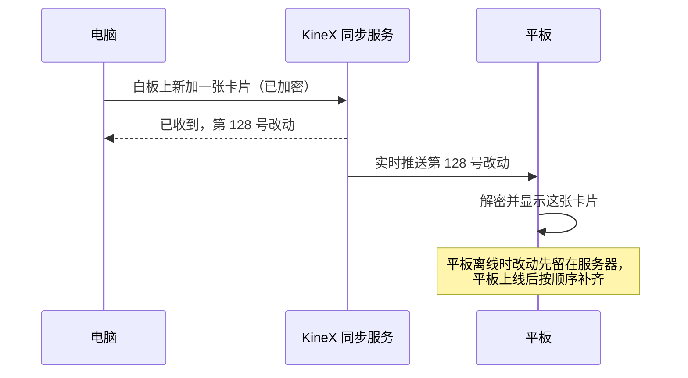

### https 与外网访问

安卓正式版必须使用 `https://` 地址。电脑版和局域网内使用可以直接用 `http://<NAS 地址>:8710`。配置好反向代理后，电脑和安卓在外网都能用同一个 `https://` 地址连接。

- **有域名：** 在飞牛的反向代理（或 Caddy、Nginx、Lucky）中把域名转到 `http://127.0.0.1:8710`，并：
  - 打开 WebSocket / SSE 支持，读超时不少于 6 分钟（实时推送使用长连接）；
  - 不要对 `/api/` 开启压缩缓冲，否则推送会延迟；
  - 上传大小上限不少于 32 MB。
- **没有公网 IP：** 可以用 Tailscale 等组网工具，为内网地址申请正式证书。

### 备份与升级

- **备份：** 使用管理面板的 Backups，或停止容器后复制整个 `data/` 文件夹。数据都是密文，但其中包含账号密码的哈希，备份要妥善保管。
- **升级：** 替换程序文件后重新构建并启动（`docker compose up -d --build`）。数据库结构会在启动时自动升级。

服务器上的备份不能代替 KineX 自己的导出备份：它保存的是加密数据，需要同步密钥才能读出。

### 目前的限制

- 实时同步下暂不能使用“用云端覆盖本机”，也不显示停用、清空、回收云端空间等操作。
- 从 S3 / WebDAV 换到 KineX 同步服务暂时没有专门引导。换之前，先让每台设备在原同步方式下同步完成，并保留完整备份；之后在设置中更换类型，第一台生成密钥，其他设备粘贴密钥加入。


*kinex-sync 管理面板的 users 列表（邮箱和编号已打码）。*

<video controls preload="none" playsinline poster="assets/v06-realtime-sync.jpg" src="assets/v06-realtime-sync.mp4"></video>

*两台设备连接同一个 KineX 同步服务：在 A 上写一张卡片，B 上马上出现。*

<a id="backup"></a>

## 14. 导出、备份与恢复

### 先选对用途

| 目的 | 应选择什么 |
|---|---|
| 分享笔记，或交给其他笔记软件 | 内容导出，例如 Markdown |
| 保存当前版面，打印或发送给别人看 | PDF 或图片导出 |
| 保存可重新导入的完整主题 | `.kinex` 主题包 |
| 在多台设备继续编辑 | 资料库同步 |
| 找回之前的内容 | 数据历史或已有完整备份 |

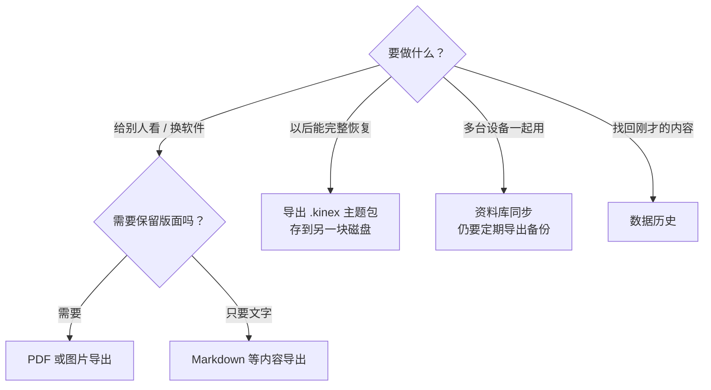

同步会传播修改和删除，仍需保留独立备份。Markdown、PDF 和图片主要用于阅读、交流，不能还原全部可编辑数据。

### 导出白板内容

打开白板右上角菜单中的导出入口，选择范围和格式。

导出 PDF 或分页图片时，“避开切断”尽量把完整卡片、编组移到下一页；“沿印刷线”按原版面裁切，便于拼接。先检查预览，再导出。

### 备份完整主题

在首页主题菜单中导出主题，或在该主题的“设置 → 数据 → 本地数据与导出”中使用“导出数据”，保存 `.kinex` 文件到独立位置。

导出后保留原文件，定期更新备份；不要只保留同一磁盘上的唯一一份。

### 导入或合并

在“本地数据与导出”选择文件后，先核对预检信息：来源主题、导出时间、数据大小和风险提示。

- **导入数据：** 用包内数据替换当前主题。
- **合并数据：** 把包内内容与当前主题合并。

确认前检查当前主题是否选对。替换、合并前会保存本机保护副本，可以在“恢复前备份”中找到；这些副本不会自动同步到别的设备。

### 数据历史

恢复资料库的旧状态，可以从“数据历史”查看可用版本，按提示确认范围后恢复。恢复前也建议另存当前重要内容。

数据历史按“自动分层保留”：越近的版本留得越密，越早的越稀。每个版本显示时间、来源、完整大小，以及新增和可释放的占用；更多信息在“技术细节”中。手机上先列出版本，点一行进入详情，左上角“返回”回到列表。


*上：数据历史；下：设置 › 数据。*

<a id="account"></a>

## 15. KineX 账号与激活码

KineX 账号用于确认这台设备可以使用全部功能、兑换激活码和提交反馈。账号**不保存你的笔记**：资料仍在本机和你自己设置的同步存储中。

账号在“设置 → 账号”。只有连接了账号服务的版本才显示这一页。

### 登录

KineX 用邮箱登录，无需密码。

1. 打开“设置 → 账号”，输入邮箱，点“获取验证码”。按钮会短暂显示“发送中…”，KineX 在后台完成一次安全校验，通常不到一秒。
2. 打开邮件，填入 6 位验证码。
3. 第一次使用这个邮箱时，勾选同意《服务条款》《隐私政策》，以及“同意将账号信息（邮箱、设备）存放在境外服务器”，点“同意并登录”。
4. 账号下已经有 5 台设备时，页面会列出这些设备：选一台退出，再在这台设备登录。

验证码输错时，页面会提示还可以试几次；验证码过期后重新获取即可。尝试次数过多时，需要等一小时再试。

### 账号页上能看到什么

| 内容 | 说明 |
|---|---|
| 邮箱 | 部分打码显示 |
| 状态 | 例如“可使用全部功能 · 到 某日”“可使用全部功能 · 永久”“可使用全部功能 · 公测到 某日”；还没有任何权益时显示“账号暂未开通” |
| 设备（n/5） | 一个账号最多 5 台设备。可以在这里让其他设备退出，页面会提示今年还能退出几次 |
| 激活码 | 输入后点“兑换” |
| 底部操作 | 退出登录 · 导出账号数据 · 注销账号 |

### 兑换激活码

在“激活码”中输入并点“兑换”，大小写和空格不影响识别。

| 激活码 | 效果 |
|---|---|
| 限期码（例如 1 个月、3 个月、1 年） | 按自然月计算：1 月 31 日兑换 1 个月，到 2 月 28 日（闰年 29 日） |
| 永久码 | 一直有效 |

多个限期码会**依次往后接**，不会重叠浪费。公测期内兑换的限期码，从公测结束那天才开始计时，账号页会多显示一行“已兑换的激活码 · 公测结束后开始，到 某日”。

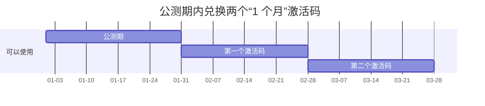

*日期只是示例：公测到 1 月 31 日，两个激活码依次排在公测之后。*

兑换失败时，页面会说明原因：激活码不对、已被使用、已过期或已停用。

### 定期联网验证

登录后，设备每天联网时自动续期一次；每次续期在 14 天内有效。

- 只要账号下有一台设备经常联网，它续期时会顺带为其他设备续期，并通过资料库同步带过去。例如平板只在家里的局域网同步、电脑每天联网，平板也会一直有效。
- 快到期时（3 天以内），右下角会安静地提示一次“N 天内需要联网验证一次，联网后会自动完成”；“设置 → 通用”中也会出现“上次验证 …”和“立即验证”。
- 超过期限仍未联网时，部分功能会提示“连接网络后即可继续使用”，联网后自动恢复。

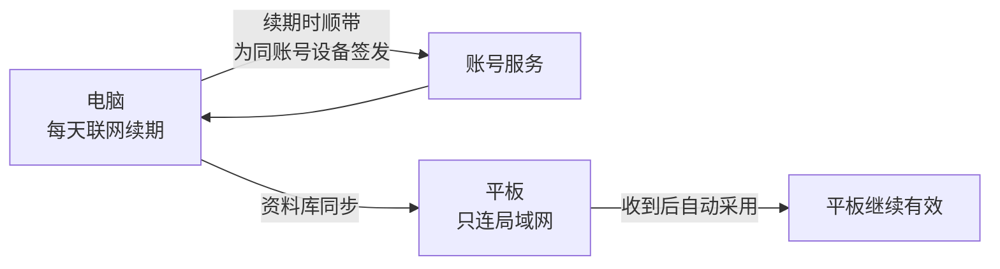

需要联网验证的功能包括：同步、中性笔以外的笔刷、音视频、朗读与听读、闪卡、网页导入、录音，以及打印分页 PDF 和图片导出。暂时用不了时：

- 已有的资料、卡片、录音都不会被改动或删除；
- 已经打开的播放器、正在读的这一次朗读不会中途切断；
- Markdown 等内容导出照常可用。

具体范围以界面和正式版公布的安排为准。

### 退出登录与注销

- **退出登录：** 直接退出，本机资料不受影响，再次登录即可恢复。被其他设备退出、或账号注销后，这台设备会自动退出登录。
- **导出账号数据：** 下载账号相关的记录，包括设备和反馈。
- **注销账号：** 需要邮件验证码确认。账号和设备记录会被删除，激活码兑换的权益一并失效，无法恢复；本机资料不受影响。你公开的建议会保留内容、去掉署名。


*设置 › 账号：兑换激活码后的状态。*

<video controls preload="none" playsinline poster="assets/v07-account.jpg" src="assets/v07-account.mp4"></video>

*用邮箱验证码登录 → 勾选同意项 → 兑换激活码 → 状态变为“可使用全部功能”。*

<a id="feedback"></a>

## 16. 反馈与开发进度

遇到问题、想要什么功能，都可以在应用里或官网上告诉开发者，也可以看到 KineX 接下来要做什么。

### 在应用里反馈

打开“设置 → 反馈”。没登录时可以浏览公开建议；提交和投票需要先登录 KineX 账号。

| 入口 | 用法 |
|---|---|
| 报告问题 | 写标题和经过。“附上版本和设备信息”默认勾选；“附上最近的错误记录”可以先点“查看内容”再决定。只有你和开发者能看到问题报告 |
| 提建议 | 边输入标题边查找相似建议，已有的话直接“投一票”。第一次提建议需要起昵称，并选择显示方式：完整昵称、只显示开头一个字或匿名。建议审核后公开 |
| 我的反馈 | 你提过的问题和建议，以及它们的进展 |
| 公开建议 | 按“热门 / 最新”浏览，给想要的功能投一票 |
| 昵称与通知 | 修改昵称和显示方式；“反馈有进展时给我发邮件” |
| 看开发进度 → | 打开官网的开发进度看板 |

每条建议的详情里可以看到官方回复和进展，可以“补充一句”，也可以打开“有进展时邮件通知我”。为防止刷屏，每人每小时最多提交 5 条、每天 10 条。

### 反馈会经历哪些状态

**建议：**

```mermaid
stateDiagram-v2
    state "待审核" as pending
    state "未通过" as rejected
    state "已收到" as open
    state "计划中" as planned
    state "进行中" as started
    state "已完成" as completed
    state "不做了" as declined
    state "重复（已合并）" as duplicate
    [*] --> pending: 提交
    pending --> open: 审核通过并公开
    pending --> rejected
    open --> planned
    planned --> started
    started --> completed
    open --> declined
    open --> duplicate: 票数和关注一并转过去
```

**问题报告：**

```mermaid
stateDiagram-v2
    state "已收到" as open
    state "处理中" as started
    state "已修复（标明版本）" as completed
    state "无法重现" as cannot
    state "重复" as duplicate
    [*] --> open: 提交
    open --> started
    started --> completed
    open --> cannot
    open --> duplicate
```

状态有变化或有官方回复时，关注了这条反馈的人会收到邮件。同一个人一天最多收到一封汇总邮件；邮件里的退订链接可以退订一条或全部。

### 官网“动态”

在 [kinexnote.com](https://kinexnote.com/updates/) 顶部点“动态”，有三个标签：

| 标签 | 内容 |
|---|---|
| 进度 | 计划中、进行中、已完成三列看板，可按分类（阅读、白板、闪卡与学习、同步、平板、其他）筛选；点开卡片能看到与它相关的建议 |
| 更新日志 | 每个版本的新功能、改进和修复，左侧按年份和版本导航，最新版本带下载链接 |
| 建议 | 与应用里的“公开建议”相同，也可以在网页上登录后提建议、报告问题和投票 |

网页登录同样使用邮箱验证码，登录状态保留 30 天。已完成的进度条目只显示最近 90 天。

```mermaid
flowchart LR
    A["你提建议"] --> B["审核后公开"]
    B --> C["大家投票"]
    C --> D["开发者挂到进度看板"]
    D --> E["进行中 → 已完成"]
    E --> F["写进更新日志<br/>邮件通知关注的人"]
```


*设置 › 反馈（我的反馈和公开建议）；提建议时的相似建议提示；官网“动态 › 进度”看板（演示数据）。*

<a id="updates"></a>

## 17. 版本更新与通知

### 检查更新

KineX 启动后会自动检查一次新版本，之后每天检查一次，只发送平台和版本号。

也可以手动检查：打开“设置 → 通用”，最上面的“版本”卡片显示当前版本和上次检查时间，点“检查更新”。

有新版本时：

- 右下角提示一次“KineX x.x.x 可以更新了”，可以看更新内容、点“更新”，或点 × 关掉；每个版本只提示一次；
- 设置左下角的版本号旁显示“有新版本”；
- 版本卡片显示“新 x.x.x · 日期 · 标题”，点“更新内容”可以查看中间所有版本的新功能、改进和修复。

### 安装新版本

| 平台 | 步骤 |
|---|---|
| 电脑安装版 | 点“立即更新”→ 下载时可以继续使用，也可以“取消”→ 下载好后点“重启并更新”。也可以先不管，下次打开 KineX 时再更新。更新完自动重启，数据不动 |
| 安卓安装版 | 点“下载并安装”→ 下载完点“安装”。第一次安装时系统会询问是否允许 KineX 安装应用，选“允许”，回到 KineX 再点一次“安装” |
| 浏览器 | 点“去官网下载” |

更新完成后第一次打开，右下角会显示“已更新到 x.x.x”和主要更新内容。

更新包在下载后会核对签名，被改动过的安装包不会被安装。连不上更新服务时，版本卡片会提示“暂时连不上更新服务，稍后会自动再试”，也可以到 [官网下载页](https://kinexnote.com/download/) 手动下载，国内备用下载在同一页。

安卓的应用内安装仍待真机验证。

### 通知

后台任务、同步问题和官方公告都放在“通知”里。

- **电脑：** 通知条显示在窗口中，可以拖动位置、折叠或展开。
- **手机：** 通知收成右上角的小铃铛，有没看过的通知时铃铛上有一个点。

日常状态不会主动打扰你；只有出错或需要你决定的事情才会自动展开。

**公告** 由 KineX 官方发布，显示标题、“公告”字样、正文和一个链接按钮。链接只会指向 kinexnote.com。点 × 关掉后，这台设备上不再出现这条公告；公告到期或下架后也会自动消失。


*设置 › 通用：有新版本时的版本卡片和“更新内容”。*

<a id="settings"></a>

## 18. 外观、手写笔、触控手势与快捷键

### 常用设置

| 位置 | 可以调整什么 |
|---|---|
| 设置 → 通用 | 版本与更新，以及一般选项 |
| 设置 → 阅读 | 词典、屏幕常亮、TXT 分章规则、网页提取规则 |
| 设置 → 朗读 | 引擎、声音、语速、读音词典和缓存 |
| 设置 → 外观 | 明暗、配色、阅读字体、主题封面样式 |
| 设置 → 快捷键 | 查看、修改或恢复各区域的默认按键 |
| 设置 → 手写笔 | 侧键、笔尾在不同区域中的操作；安卓版还有湿墨相关设置 |
| 设置 → 触控手势 | 白板移动方式、多指手势在各区域做什么 |
| 设置 → 搜索索引 | 全文索引的进度与维护 |
| 设置 → 同步 | 同步类型、连接、密钥和同步方式 |
| 设置 → 数据 | 资料库文件夹、本地数据与导出、恢复前备份 |
| 设置 → 账号 / 反馈 | 见第 15、16 节（连接了账号服务的版本才有） |

大多数外观调整即时生效。滑块可以双击恢复默认。

KineX 有四套配色，默认是中性灰。闪卡、白板卡片和学习统计的颜色会跟随所选配色。

### 触控手势

在“设置 → 触控手势”中，可以为白板、阅读区、播放窗、闪卡、切换与全局五个区域分别设置手势。每个手势是一个下拉框，可以选本区命令、通用命令、“录制按键…”或“不做事”；删除类命令不会出现在列表里。

默认手势：

| 手势 | 默认操作 |
|---|---|
| 双指单击 | 撤销（播放窗为撤销画面标注；闪卡为撤销评分） |
| 三指单击 | 重做 |
| 三指左右扫 | 切到另一区（阅读区 ⇄ 白板） |
| 三指张开 / 捏合 | 手指所在区放大到 100% / 回到并排 |
| 平板顶栏空白处左右滑 | 切到另一区 |
| 其他多指点按、滑动、捏合，以及长按 | 默认不做事，按需要自己设定 |

- **多指连点：** 可选“连续撤销”（连点几下撤销几步，提示“撤销 ×3”）或作为单独的手势。
- 手势识别成功时，手指处会短暂显示命令名称；可以在本页关掉手势提示。
- 阅读区和闪卡上的滑动、捏合在手指抬起后才执行，避免和翻页、缩放冲突。
- “手势说明 · 再看一次”可以重新查看说明；每个区域都能“恢复本区默认”。

没有触屏的电脑上，本页会提示“这台设备没有检测到触屏”。


*设置 › 触控手势：白板区域的手势。*

### 常用默认快捷键

以下以 Windows 的 Ctrl 写法为例。快捷键按鼠标所在区域或当前焦点生效；输入文字时，优先执行文字编辑。

| 区域 | 按键 | 操作 |
|---|---|---|
| 通用 | Ctrl+F / Ctrl+Shift+F | 当前区域查找 / 全局搜索 |
| 通用 | Ctrl+, | 打开设置 |
| 布局 | Alt+1 / Alt+2 / Alt+3 | 100% 阅读区 / 并排 / 100% 白板 |
| 布局 | Alt+Q；Alt+\；Alt+Shift+\ | 切到另一区；左右 / 上下排列；交换位置 |
| 布局 | Alt+M / Alt+O / Alt+W | 素材管理面板 / 目录 / 白板列表 |
| 阅读区 | T / A / B / H / E / R / M | 文本选择 / 自动摘录 / 手写笔 / 荧光笔 / 橡皮 / 矩形框 / 选区 |
| 阅读区 | Ctrl+= / Ctrl+- / Ctrl+0 | 放大 / 缩小（文字材料为字号）/ 适配页宽 |
| 阅读区 | Ctrl+G | 跳到页码（PDF） |
| 白板 | V / T / B | 移动 / 文本框 / 手写笔 |
| 白板 | H / E / M | 马克笔 / 橡皮 / 选区 |
| 白板 | 按住空格并拖动 | 临时移动画布 |
| 白板 | Ctrl+Z / Ctrl+Y | 撤销 / 重做 |
| 白板 | Ctrl+G | 编组选区 |
| 白板 | Shift+1 / Shift+2 | 全部预览 / 缩放到选区 |
| 白板 | Alt+↑；Enter | 返回上一级白板；进入子白板或编辑所选卡片 |
| 白板 | Alt+拖动 / Ctrl+Alt+拖动 | 矩形选择 / 自由套索 |
| 选文制卡 | Alt+X / Alt+Z | 制作 Topic / Item |
| 闪卡复习 | 空格；1 / 2 / 3 / 4 | 显示答案；四档评分 |
| 播放器 | 空格；← / → | 播放或暂停；前后跳转 |
| 播放器 | I / O / L | 设置 A 点 / B 点 / 循环 |
| 视频播放器 | S / P；F | 截帧 / 画面标注；全屏 |
| 朗读 | Ctrl+Alt+空格 | 播放或暂停 |
| 朗读 | Ctrl+Alt+← / → | 上一句 / 下一句 |
| 朗读 | Ctrl+Alt+E | 摘录本句 |
| 桌面朗读 | Ctrl+Alt+F | 显示或隐藏小窗 |

朗读的部分按键在桌面安装版中可全局使用，可能与其他软件冲突；可以在设置中改键或限制为页面内使用。自定义过快捷键时，以设置页显示为准。某个新默认键已被你分配给其他命令时，新命令会显示“未设置”，不会出现一键两用。

<a id="faq"></a>

## 19. 常见问题

### 界面与输入

**找不到素材、同步或录音按钮。**  
先查看顶栏“⋯”。手机主题内先展开顶部窄条，阅读入口还可能在阅读条里（点页面中间）。

**鼠标或手指不能写字。**  
先选择手写笔工具，再检查“鼠标 / 触控出墨”开关。硬件笔与鼠标、手指使用不同的输入设置。

**平板上单指拖不动白板，只会框选。**  
触屏默认“双指移动”。用双指拖动画布，或在“设置 → 触控手势”中改成“单指移动”。

### 阅读、闪卡与音视频

**选中文字后没有制卡入口。**  
切回文本选择工具。高亮、手写等工具下不会弹出选文制卡按钮。

**PDF 选不中字，也不能朗读。**  
可能是扫描页，没有文字层。可以先截图摘录；搜索和朗读不会自动进行文字识别。

**刚做的卡没有进入今天的复习。**  
新卡会安排首次日期，不一定当天出现。到闪卡管理中查看，或通过“现在开始阅读”打开 Topic。

**视频换设备后不能播放。**  
检查它是否引用原文件。引用只同步记录；需要重新绑定本机文件，或让来源设备在线并满足局域网播放条件。在线媒体还要检查服务和登录状态。

**找不到朗读声音或接口。**  
先确认引擎已安装声音、转发服务已开启；跨设备时确认同一网络及手机地址正确。声音与接口需要在每台设备分别选择。

**原文修改后，批注位置不对。**  
先核对是否替换了材料版本。文字类材料可尝试按原文重新定位；PDF 批注主要按页面位置保存，换页或重新排版后需要人工检查。

**搜索没有结果。**  
检查范围、筛选条件和索引进度。尚未建立索引的正文、扫描页及未提供文字的音视频，不会自动变成可搜索全文。

### 同步与备份

**可以只复制资料库里的 Markdown 当备份吗？**  
文字版适合查看，不能恢复全部白板、排程和附件。要恢复主题，请保留完整 `.kinex` 包；资料库级恢复另按完整备份或数据历史操作。

**同步显示有问题。**  
先查看同步窗口的具体提示，检查连接、存储权限和密钥；有冲突则打开“需要你决定”。不要为了消除提示直接覆盖本机或云端。

**提示“连不上 KineX 同步服务”。**  
改动会先留在本机，连上后自动补齐。检查 NAS 是否开机、容器是否运行、地址和端口是否正确；在平板上使用时，确认填写的是 `https://` 地址。

**平板连不上自建同步服务，电脑可以。**  
安卓正式版只允许加密连接。为同步服务配置 https（见[第 13 节](#self-hosted-sync)），再在平板上填写 `https://` 地址。

**新设备粘贴密钥后解不开云端资料。**  
确认粘贴的是第一台设备生成的那一行完整密钥，并且新设备填写的是同一个同步目标（同一个服务器或存储路径）。同步密钥和存储密码、同步服务密码不是一回事。

### 账号与更新

**收不到验证码。**  
先查看垃圾邮件文件夹，确认邮箱拼写正确。需要重新获取时，等按钮上的倒计时结束；提示“尝试次数过多”时，一小时后再试。

**提示“请更新 KineX 后再获取验证码”或“请更新到最新版本”。**  
当前版本太旧，到“设置 → 通用 → 版本”更新，或到官网下载页安装新版本。

**提示“连接网络后即可继续使用”。**  
这台设备太久没有联网验证。连上网络即可自动恢复，资料不会丢失。另一种办法是让同一账号下常联网的设备同步一次。

**登录时提示设备已满。**  
一个账号最多 5 台设备。在列表中选一台不再使用的设备退出，再在这台设备登录。每年让其他设备退出的次数有限，请留意页面上的剩余次数。

**更新一直下载不完，或安装失败。**  
在版本卡片中“取消”后重试；仍不行时，到官网下载页手动下载安装包，国内备用下载在同一页。

**关掉的公告还能找回吗？**  
不能。公告点 × 后在这台设备上不再显示；需要时可以到官网“动态”查看。
